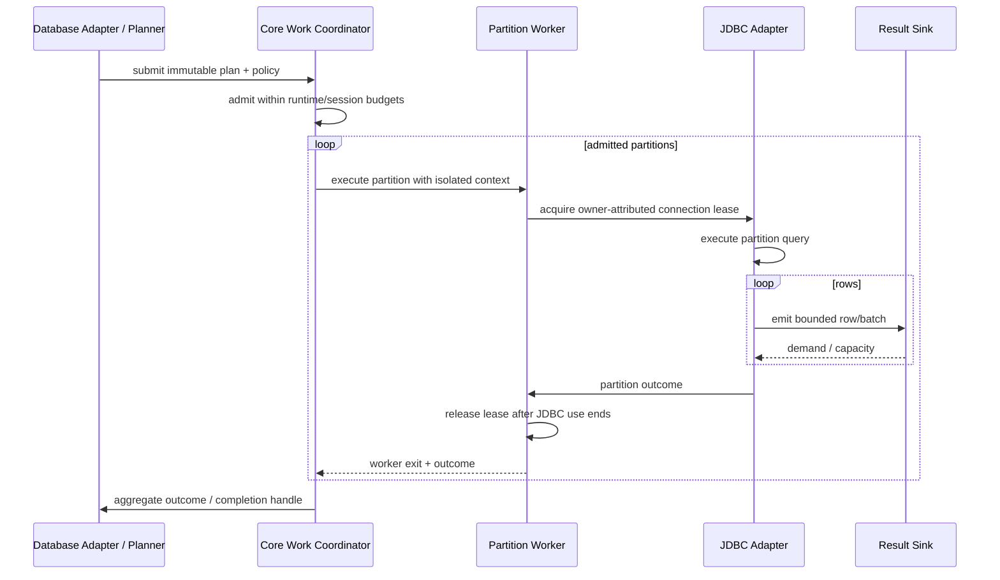
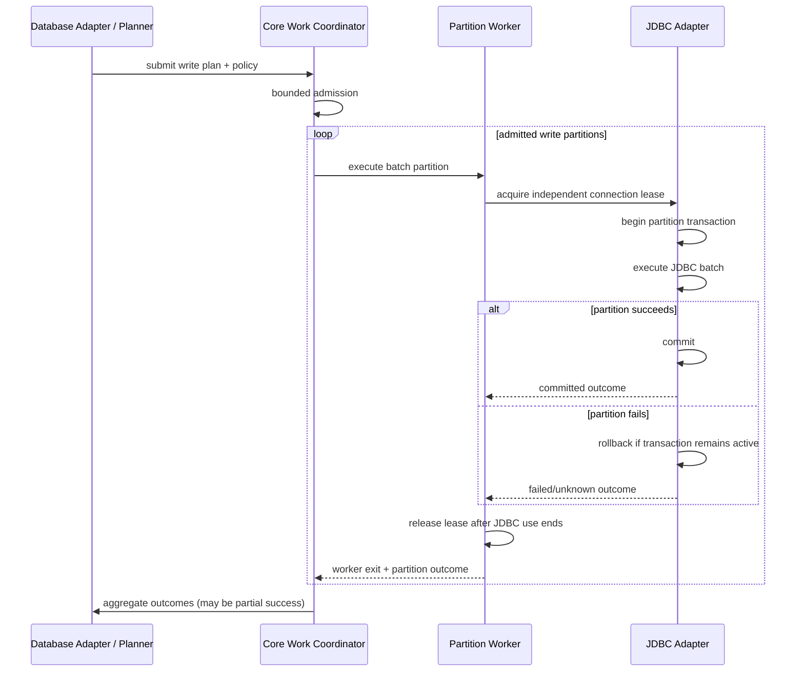

# Execution Architecture RFC: bounded and partitioned work

**Status:** Proposed architecture; no runtime implementation authorized by this document alone  
**Scope:** Core execution contracts and technology adapters, with JDBC as the first consumer  
**Related work:** PR #381 (JDBC resource leases), Issue #382 (DatabasePlugin decomposition)

> **Evidence baseline:** lifecycle implementation details in sections 5.1–5.2 were inspected on the active integration base used by PR #381 (`007207821a19ad45e722f0e9029ae9472e3c6f10`), not assumed to be present on `main` yet. PR #381 is still open and Draft. Treat `ExecutionOwner`, `ExecutionResourceAccess`, `ResourceLedger`, and the corresponding session execution tracking as the lifecycle foundation being integrated; do not imply that the main branch already contains all of it.

## 1. Decision

WebHarvest should provide a technology-neutral Core capability for planning and executing bounded units of work. Database/JDBC is an adapter and an early consumer, not the owner of the scheduler or the generic partition execution model.

The immediate architectural goal is to establish stable Core extension points before parallel execution is implemented. This is specifically intended to avoid later migrations of stabilized plugin APIs and runtime lifecycle code.

The existing Maven direction is correct: `webharvest-database` depends on `webharvest-core`; Core must not depend on JDBC, DBCP, vendor drivers, SQL dialects, or database-specific partitioning classes.

## 2. Two distinct workload semantics

### 2.1 Partitioned reads

A logical read may be represented by multiple disjoint or explicitly overlapping work partitions. Strategies may include numeric/date ranges, hash/modulo, explicit SQL predicates, or adapter-defined partitions.

Required semantics to define:
- partition identity and coverage (including gaps/overlaps);
- result ordering: globally ordered, partition ordered, or unspecified;
- bounded streaming/backpressure; avoid mandatory whole-result materialization;
- snapshot/consistency policy across independently executed queries;
- skew detection and optional partition sizing;
- deterministic error and partial-result reporting.

A range split based only on MIN/MAX is not proof of balanced work. The adapter/planner must be able to report unknown distribution and avoid promising balanced execution.

### 2.2 Parallel writes

Writes have different guarantees and must not be treated as the inverse of reads.

Required semantics to define:
- input batching separately from parallel partition execution;
- independent transaction boundaries and commit outcomes;
- partial success, failure aggregation, and retry eligibility;
- idempotency/deduplication contract for retries;
- staging-and-merge as a possible adapter strategy;
- ordering and constraints when writes target related rows or shared keys.

A parallel write is not implicitly one atomic transaction. Core must expose that distinction rather than imply global rollback.

## 3. Proposed Core boundary

The first Core API should be deliberately small, immutable where possible, and independent of SQL and data-source implementation details.

Candidate concepts for API review (names are provisional):
- **WorkPlan** — immutable description of one logical operation and its planned work.
- **WorkPartition** — one independently schedulable unit, with stable identity and opaque adapter-owned payload/descriptor.
- **ExecutionPolicy** — requested/allowed concurrency, ordering, failure behavior, and resource budgets.
- **WorkExecutor** — runtime-owned bounded execution service that accepts a plan and policy.
- **WorkExecution** — handle for observing completion, results/stream, cancellation request, and terminal outcome.
- **WorkResult / PartitionOutcome** — explicit per-partition and aggregate outcomes, including partial success and failures.

The API review must decide whether read-result streaming belongs in a separate sink/consumer contract rather than in a generic result object. Core must not force every workload to materialize a collection.

Do not add a generic workflow DAG, durable distributed job manager, cluster scheduler, SQL planner, or vendor-specific partition classes as part of this first SPI.

## 4. Runtime and lifecycle integration

The execution service must be session/runtime-owned and bounded. It should use a host-provided executor where appropriate, or a runtime-managed bounded executor with explicit ownership and shutdown semantics. It must not create an unbounded thread per partition.

The existing execution lifecycle and resource model are foundational:
- `ExecutionOwner` attributes work to its owning execution.
- `ExecutionResourceAccess` and `ResourceLedger` distinguish resource registration from active-use leases.
- Cancellation/interruption is a request, not proof that a worker exited.
- A resource lease must remain held until the actual operation stops using the resource.
- Quiescence and resource drain may only be declared after worker exit is observed.
- Unconfirmed JDBC cancellation/close must remain visible as failed or quarantined; never report a hard abort without evidence.

The SPI must define how child work is registered with the owning session, how all children are cancelled, how actual worker exit is observed, and how a session waits/drains without releasing resources still in use.

## 5. Context isolation

Do not share a mutable `DynamicScopeContext` across concurrent workers.

Before implementation, define an explicit per-partition execution context:
- immutable/shared read-only inputs where safe;
- isolated local variable scope and result channel;
- explicit propagation of execution owner, cancellation signal, tracing/correlation and resource access;
- deterministic merge rules for outputs;
- no implicit concurrent mutation of session variables.

The existing synchronous plugin contract remains valid. Parallel work should be an opt-in execution capability, not a silent change to the semantics of `Plugin.execute(context)` or `<loop>`.


## 5.1 Executor topology and admission (important implementation constraint)

The current `WebHarvestServiceImpl` default session executor is created with `Executors.newCachedThreadPool`; the service can also receive a host-supplied `ExecutorService`. This is the existing session-execution mechanism, not a safe implicit budget for future partition workers.

Do not simply submit child partitions to the session executor and synchronously wait for them: a bounded shared pool can starve or deadlock when parent session tasks occupy its workers. Conversely, creating a separate fixed-size pool per session multiplies the effective concurrency by the number of sessions and defeats a runtime-wide resource budget.

The SPI design must therefore explicitly decide:
- a runtime-wide bounded partition-work admission budget, distinct from session admission;
- per-session/per-operation sub-budgets so one large session cannot monopolize all workers;
- non-blocking completion/continuation or another starvation-safe coordination model;
- host executor injection and ownership/shutdown semantics;
- queue bounds and rejection/backpressure behavior;
- interaction with JDBC connection-pool limits and other adapter resource budgets.

The contract must not promise a concurrency level that the runtime cannot admit. Effective concurrency is the minimum of requested policy and available runtime/session/adapter budgets. A caller-supplied executor's capacity and ownership must not be guessed.


## 5.2 Context isolation: current implementation is not a worker fork

Inspection of `DynamicScopeContext` and `ScraperContext` confirms that `executeWithinNewContext(Callable)` is a lexical scope operation on the same context instance, not a context clone or concurrent worker fork. `ScraperContext` mutates a shared `scopeStack`, `centralReferenceTable`, and ordinary `HashMap`/stack structures. It must not be used to create parallel partition contexts.

The SPI therefore needs a separately designed context-fork/worker-input contract. It must define which values are shared read-only, which values are copied or isolated, how mutable `Variable` instances are treated, how system/config/session metadata is inherited, and how results are returned without concurrent writes into the parent variable table. Do not add a shallow-copy helper and call it thread-safe without proving the mutability and aliasing rules of the complete variable graph.


## 5.3 Sequence sketches

These diagrams describe intended responsibility and lifecycle boundaries, not implemented behavior.

### Partitioned read



Cancellation path: Core requests cancellation of outstanding workers; JDBC adapters may attempt statement cancellation. The coordinator must still observe each worker's actual exit before marking its owner quiescent and draining its leases. A cancellation request or Future cancellation alone is not worker-exit evidence.

### Parallel write



The aggregate write outcome must not imply a global transaction. A commit whose acknowledgement is lost may have an unknown outcome; retry safety requires an adapter/application idempotency contract.

## 5.4 Parent/child task lifecycle

The current service observes the session task's exit and only then calls `markOwnerQuiescentAndDrain`. Partition workers introduce a task tree beneath that session task. The root task must not publish session-owner quiescence while any admitted child worker can still use a session-owned resource.

The runtime contract must therefore track every admitted child to a terminal worker-exit fact, including queued tasks that are positively removed before start. On cancellation:
1. stop admitting new child work;
2. request cancellation/adapter abort for every admitted child;
3. retain each child's resource leases until that child actually exits;
4. observe all child exits (or confirmed pre-start removal);
5. only then allow the root session task to publish owner quiescence and drain session resources.

The parent must not block a worker from the same bounded pool while waiting for children. Completion coordination must be starvation-safe. A child task identity is useful for partition-level metrics and outcomes, but it must not be confused with or replace the immutable session `ExecutionOwner` used by the current resource ledger.

## 6. Adapter responsibilities

The Core contract owns generic work lifecycle and policy. Adapters own technology-specific planning and execution.

For JDBC, the Database module owns:
- JDBC connection acquisition and pool interaction;
- dialect/capability discovery and safe query construction;
- SQL predicates and partition-boundary discovery;
- statement fetch size, batch size, transaction handling;
- database-specific snapshot/isolation behavior;
- mapping JDBC rows into WebHarvest values or a streaming sink.

Core must not know JDBC `Connection`, `Statement`, `ResultSet`, SQL syntax, or database vendor names.

The same Core execution SPI should later be usable by HTTP/API, file, and other data-source adapters without JDBC dependencies.

## 7. DatabasePlugin boundary

Keep `DatabasePlugin` in `webharvest-database`. It should remain a compatibility-facing XML adapter/orchestrator and delegate to cohesive database services.

Its existing XML contract, named/inline connection behavior, result XML shape, exception precedence, and legacy compatibility must be preserved during decomposition.

The Database module should consume Core execution contracts only after those contracts are reviewed and stable. Do not implement parallel execution inside DatabasePlugin while the Core SPI is unsettled.

## 8. Delivery plan and priorities

| Priority | Work | Gate / outcome |
|---|---|---|
| P0 | Complete and stabilize PR #381 JDBC resource lifecycle | Exact-head required CI green; preserve draft/review gate |
| P1 | DatabasePlugin characterization and behavior-preserving decomposition (#382) | Existing XML behavior and cleanup semantics covered; no speculative parallel engine |
| P1 | Core execution SPI design and lifecycle/context review | Agree public contracts, ownership, cancellation, streaming and compatibility before implementation |
| P2 | Add minimal Core interfaces/value types and contract tests | No JDBC dependencies in Core; no executor implementation required yet |
| P2 | Sequential plan execution through the new SPI (if needed to validate contracts) | Prove contract without introducing concurrency semantics prematurely |
| P3 | JDBC batch writes | First measurable throughput improvement; explicit transaction/partial-failure semantics |
| P3 | JDBC partitioned reads | Bounded concurrency, streaming, partition coverage and consistency policy |
| P4 | Adaptive planning and skew-aware partition sizing | Only after real metrics and multi-database evidence |

P1 activities may be parallelized only where they do not change the same code or destabilize PR #381. The Core SPI must not be hidden inside the DatabasePlugin decomposition.

## 9. Non-goals and guardrails

- No Spark/Sqoop clone and no mandatory distributed runtime.
- No default parallelism for existing XML configurations.
- No unbounded queues, unbounded worker creation, or unbounded result buffering.
- No sharing JDBC connections concurrently unless an adapter/driver contract explicitly supports it.
- No global transaction guarantee across independent write partitions.
- No implicit ordering guarantee for parallel reads.
- No speculative public API proliferation: prefer the smallest stable SPI and document extension compatibility.
- No migration of existing synchronous plugin behavior merely to make it parallel.

## 10. Acceptance criteria for the Core SPI

1. Core has no compile/runtime dependency on JDBC or database modules.
2. API expresses logical plan, partition identity, execution policy, lifecycle handle, and explicit outcomes without exposing adapter internals.
3. Cancellation request, worker exit, quiescence, lease drain, and physical close remain distinct states/events.
4. Each worker has isolated context and explicit owner/resource attribution.
5. Backpressure/streaming is possible without forcing materialization.
6. Partial success and failure aggregation are representable.
7. Read ordering and consistency are explicit policies, not accidental guarantees.
8. Existing synchronous plugin and XML behavior remain unchanged.
9. Contract tests cover bounded admission, cancellation/exit ordering, resource lease retention, isolation, partial failure and deterministic result semantics.

## 11. Current architectural conclusion

The database module boundary is already in the correct direction. The missing piece is not moving JDBC code again; it is introducing the smallest technology-neutral execution SPI in Core before Database and other adapters begin depending on ad-hoc concurrency APIs.

The next implementation step is therefore the Core contract, not a parallel JDBC implementation.

## 12. Concrete Core API proposal (under review)

Source inspection on the active integration base supports a narrow capability API rather than exposing an executor:

- `ExecutionOwner` is already the immutable runtime/session/generation identity and remains canonical.
- `ExecutionResourceAccess` is already the plugin-facing, owner-bound resource capability. The host-side coordinator and ledger must remain hidden from adapter code.
- `WebHarvestService` is the session-level API; partition work should be an optional capability of a managed execution, not a second public session service.
- `ScraperContext` cannot be shared by workers, and neither `executeWithinNewContext` nor `NestedContextFactory` provides a safe fork.

### 12.1 Proposed package and contracts

Proposed package: `org.webharvest.runtime.execution`.

The following names and signatures are candidates for review, not published API yet:

```java
public interface ExecutionWorkAccess {
    ExecutionOwner getOwner();

    <P, R> WorkExecution<R> submit(
        WorkPlan<P> plan,
        WorkExecutionPolicy policy,
        PartitionTask<P, R> task);
}

public interface PartitionTask<P, R> {
    R execute(WorkPartition<P> partition, PartitionContext context) throws Exception;
}

public interface WorkExecution<R> {
    boolean requestCancellation();
    CompletionStage<WorkResult<R>> completion();
}
```

Supporting immutable value types and callbacks:
- `WorkPlan<P>`: stable plan identity and finite, immutable partition descriptors. The initial contract bounds/validates plan size; a future lazy partition source requires its own bounded producer/admission contract and is not silently implied by `Iterable`.
- `WorkPartition<P>`: stable ID unique within the plan plus opaque adapter-owned payload. Core does not parse SQL, file paths, HTTP requests or vendor expressions.
- `WorkExecutionPolicy`: requested in-flight limit and explicit fail-fast/continue policy. Runtime, session and adapter budgets may reduce concurrency; `WorkExecution` exposes the effective admitted ceiling.
- `ExecutionWorkAccess`: optional owner-bound submission capability; exposes neither `ExecutorService` nor thread creation nor host lifecycle authority.
- `PartitionContext`: canonical session owner, owner-bound `ExecutionResourceAccess` and cooperative cancellation checks. It must not expose the parent `DynamicScopeContext`.
- `PartitionTask` / `StreamingPartitionTask`: adapter callbacks for result-only or streaming partitions.
- `WorkExecution`: cancellation request and completion stage, where completion follows actual worker exit or positively confirmed pre-start removal.
- `WorkResult<R>` and `PartitionOutcome<R>`: immutable aggregate and per-partition outcomes, including partial success and unknown outcome. Results carry the plan ID and preserve original plan order; they must not imply cross-partition atomicity.

The `ExecutionWorkAccess` capability is optional on service-managed contexts. Legacy/third-party contexts retain null/default-unsupported behavior, following the compatibility pattern already used for resource access. The managed context binds it once and verifies the existing immutable `ExecutionOwner`.

### 12.2 Context and streaming boundaries

The first SPI does not claim to clone the current variable context. `PartitionContext` carries execution metadata and explicit adapter inputs only. If worker-side template evaluation requires parent variables, define and test an immutable input-snapshot contract—including mutable `Variable` aliasing—before exposing it.

Streaming output is separate from `WorkResult`. The proposed first contract uses `PartitionEmitter<T>` and a supplied `PartitionOutputHandler<T>`: emission is synchronous, handler calls are serialized by the runtime, and the handler runs on the producing worker. A slow handler therefore applies natural backpressure without a result buffer or per-plan output executor. Per-partition emission order is preserved; cross-partition order is unspecified. The handler must not synchronously wait for the same `WorkExecution` to complete. This callback contract must be validated for cancellation and handler failure before any executor implementation.

### 12.3 Lifecycle obligations

The runtime implementation behind `ExecutionWorkAccess` must:
1. register a child before it can run and attribute it to the existing session `ExecutionOwner`;
2. enforce runtime-wide bounded admission and per-session fairness without reusing the session executor as an implicit partition pool;
3. stop child admission and fan out cancellation when the parent is terminating;
4. distinguish queued work positively removed before start from work that actually started;
5. retain resource leases until each worker's actual exit;
6. complete the public `WorkExecution` only after every admitted child has exited or has been confirmed removed before start;
7. allow the root session to publish owner quiescence and drain resources only after all children are terminal.

The parent must not occupy a worker from the same bounded pool while synchronously waiting for its children. Child identity is for partition outcomes/metrics; it does not replace the session owner.

### 12.4 Recommended decisions to close the first SPI

The following choices are recommended as the smallest safe first version:

1. **Optional context capability:** add a default `getExecutionWorkAccess()` returning null to `DynamicScopeContext`, and a default setter that rejects non-null binding, mirroring the existing owner/resource-access compatibility pattern. The concrete service-managed context binds the capability once, before publication, and verifies the same `ExecutionOwner`.
2. **Finite plan and bounded admission:** make `WorkPlan` an immutable finite descriptor list with an explicit maximum partition count. The runtime validates the complete plan and either admits it atomically or rejects it before any partition starts; no partially admitted plan is reported as accepted. Runtime-wide and per-session pending limits are hard bounds. Initial API uses non-blocking rejection (a typed admission exception/result), not a caller thread blocked waiting for queue capacity. A lazy/dynamic partition source is a later extension with its own pull-based bounded contract.
3. **Streaming and backpressure:** keep streaming separate from aggregate `WorkResult`. The first SPI may expose an optional synchronous `PartitionEmitter<T>` plus a `PartitionOutputHandler<T>` supplied at submission. The runtime serializes handler calls and invokes the handler directly on the producing worker; a slow handler therefore blocks producers and provides natural backpressure without an intermediate queue or output thread pool. The callback receives partition identity with each item; cross-partition ordering is explicitly unspecified, while per-partition emission order is preserved. The handler must not synchronously wait for the same `WorkExecution` to complete. Add this contract only if the first implementation can test serialization, cancellation and callback failure deterministically.
4. **Worker inputs:** do not snapshot or clone `DynamicScopeContext` in the first SPI. Carry only immutable metadata and adapter-owned immutable partition payloads. Add a separately reviewed immutable variable snapshot only when a real adapter requires it.
5. **Initial implementation:** add public contracts and deterministic contract tests first. Do not add an executor implementation until runtime-wide admission, child tracking and parent quiescence can be proven against the actual session lifecycle. A sequential reference executor is optional and should be added only if it validates a real contract that cannot be tested directly.

The atomic plan-admission rule deliberately avoids a half-started plan when the queue is saturated. It also means the initial finite-plan cap is a real API limit, not an implied promise to handle arbitrarily large partition counts. The cap must be configurable by the runtime and visible in admission diagnostics.

These are recommended decisions for review in [Issue #383](https://github.com/web-harvest/web-harvest/issues/383), not authorization to implement concurrent workers or parallel JDBC.


### 12.5 Initial Core SPI implementation branch

The first contract-only implementation is tracked in [PR #384](https://github.com/web-harvest/web-harvest/pull/384), targeting the active `runtime/execution-resource-context` integration branch so it does not absorb or merge the JDBC lifecycle work in PR #381. It adds the public descriptor, policy, task, context, execution, outcome and streaming callback types, plus optional `DynamicScopeContext` capability binding. It intentionally contains no scheduler, executor, queue, child registry or parallel JDBC implementation. CI must pass on the corrected PR head before this API is treated as stable.

### 12.6 Streaming/backpressure contract details

The initial synchronous streaming design is retained, with the following implementation obligations:

- The output serialization gate is scoped to one admitted `WorkExecution` and its handler. Independent plans must not share a runtime-global output lock.
- `PartitionEmitter.emit(item)` returns only after the handler has processed that item. The runtime does not queue or buffer pending output items. A slow handler blocks its producer; this bounds runtime-owned pending output to the active producer calls rather than allowing backlog growth. Items retained by the handler are consumer-owned memory and outside this guarantee.
- Per-partition emission order is preserved. Cross-partition order is unspecified. Serialization alone does not promise fairness or FIFO admission between producers; do not claim either without a separately specified and tested scheduler.
- A handler exception fails the emitting partition with the original cause and is processed through the plan's declared `WorkFailurePolicy`. It must not be swallowed or treated as successful emission.
- Cancellation while a worker is inside a handler does not establish worker exit. The worker and its resource leases remain live until the callback returns or the worker actually exits. Plan completion and session-owner quiescence must wait for that terminal event.
- A handler must not synchronously wait for the same `WorkExecution.completion()`; this creates a dependency cycle. Recursive/reentrant emission on the same plan is unsupported unless explicitly designed and tested.
- Handlers are adapter/consumer code and may block. This is intentional backpressure but consumes a partition worker and delays plan completion; the runtime must not conceal this by adding an unbounded helper queue.

Required deterministic tests before executor implementation: serialization within one plan; no serialization coupling between independent plans; producer blocking until handler release; callback failure mapping under both failure policies; cancellation while callback is blocked with lease retention until actual worker exit; per-partition order; and no plan completion before callback/worker exit. Use latches/barriers rather than timing sleeps.

The finite-plan size limit is enforced by the service-owned admission layer, not by the Core `WorkPlan` constructor: the complete partition count must be checked against the configured cap before any partition starts. Admission rejection must expose enough diagnostics to identify the configured limit. `WorkPlan` snapshots the descriptor list, but `WorkPartition` payloads remain caller-owned and are not deep-copied; callers must provide immutable payloads or guarantee no mutation for the plan lifetime.


### 12.7 Coordinator observability and EventBus integration

The execution coordinator is both the authority for child-work lifecycle and the source of structured operational events. Observability is a first-class architecture requirement: it provides useful structured logging immediately and enables future metrics, tracing and telemetry without coupling Core or adapters to a monitoring vendor.

The implementation must first reconcile the existing event abstractions and runtime wiring. Core already contains `org.webharvest.events.EventSink` / `HarvesterEvent` and `HarvesterEventSink`; session lifecycle events use the runtime-shared Guava EventBus. The coordinator must use the established runtime event route where appropriate, not introduce a second unrelated bus. The exact event API and class hierarchy remain subject to inspection/API review.

Candidate immutable control-plane events include:
- plan admitted/rejected, including plan ID, canonical owner, partition count, effective limits and bounded rejection reason;
- partition queued/started/exited/confirmed-removed-before-start, including plan/partition IDs, queue wait, execution duration and terminal outcome;
- cancellation requested/observed, clearly distinguishing the request from actual worker exits;
- plan terminal outcome, emitted only after all children are terminal;
- session children drained, before session-owner quiescence;
- sampled admission-pressure snapshots/counters, rather than one event for every repeated rejection.

Event envelopes should carry canonical `ExecutionOwner` and applicable runtime/session/plan/partition identity, immutable payloads, an `Instant` timestamp and a monotonic per-runtime sequence (or equivalent ordered event ID). Wall-clock timestamps alone do not establish cross-thread ordering. Do not place SQL text, credentials, row contents, arbitrary adapter payloads or unbounded user strings in event payloads or metric labels.

Events are observational: subscriber, logger or exporter failures must not corrupt admission, cancellation, worker-exit bookkeeping, lease retention or quiescence. Current EventBus delivery may invoke subscribers synchronously. Therefore capture immutable event data while holding internal locks if needed, release coordinator/plan/session/ledger locks, and only then publish. Never invoke subscriber code while holding lifecycle locks.

Avoid per-row/per-item lifecycle events. Prefer bounded-cardinality counters and duration measurements for admission pressure, queue wait, active/running/queued children, output-handler blocking, cancellation-to-exit latency, active resource leases and resource drain. ResourceLedger remains authoritative for resource states; the coordinator reports task lifecycle and correlates resource outcomes without duplicating resource ownership.

The observable lifecycle should allow reconstruction of this order:
`admission-stop/cancellation-request -> child cancellation requests -> actual child exits or confirmed pre-start removals -> plan terminal -> session children drained -> session owner quiescence -> resource lease drain -> physical close or close failure`.

Business session completion, worker exit, plan completion, owner quiescence, lease drain and physical close are distinct facts. A plan terminal event must not imply that its JDBC resources are already closed. EventBus delivery is in-process and best-effort; it is not durable event sourcing or an exactly-once telemetry transport.

The synchronous `PartitionEmitter` remains the data-plane backpressure mechanism. Lifecycle events must not create an unbounded side queue. If asynchronous telemetry export is introduced later, it requires a separately bounded queue, explicit drop/sampling policy, overflow counters and shutdown-drain semantics. A slow exporter must not become an unbounded memory sink or prevent worker-exit bookkeeping.

No event classes, telemetry queue or exporter are implied by this design section. Add them only after the existing EventSink/EventBus route and deterministic lifecycle ordering tests have been reviewed.


## 12.8 Source-level integration findings and deterministic race-test matrix

The following inspection was performed on the active integration branch at `runtime/execution-resource-context`, commit `007207821a19ad45e722f0e9029ae9472e3c6f10` (service source blob `56115f508489076d5430a9a1c3c2675c3836d7e6`; session source blob `1e2b7f35222e5dbd0153b5499140ec0e6956074b`). These observations are branch-specific and must not be read as claims about `main` before the stack is integrated.

### Existing event route — reuse the bus, not the Harvester EventSink

- `WebHarvestServiceImpl` receives one Guava `EventBus` and passes that same instance to each `ScraperSessionImpl` (service constructor and `executeSession`). This is the existing runtime/session event route.
- `ScraperSessionImpl` posts `SessionCreatedEvent`, `SessionStartedEvent`, `SessionCompletedEvent`, `SessionFailedEvent` and `SessionCancelledEvent` to that bus. The latter four state-transition posts happen after the session's intrinsic state monitor is released. Cancellation invokes the service cancellation handler before posting `SessionCancelledEvent`; the event therefore reports a business cancellation request/state, not worker exit.
- `EventSink` / `HarvesterEventSink` is not a suitable direct publisher for coordinator events in its current form. It accepts only `HarvesterEvent`, whose contract requires a `Harvester` route; `HarvesterEventSink` resolves the bus through a Harvester-to-EventBus registry. Runtime/session/plan/partition events are owned by `ExecutionOwner`, not by a Harvester route. Do not force a fake Harvester identity or add a second EventBus.
- Recommended direction: add typed immutable execution-lifecycle events and publish them to the already-injected runtime EventBus through a narrow publisher seam. Include canonical owner/runtime/session/plan/partition identity and a monotonic sequence. The sequence records logical event order; concurrent publishers may still deliver callbacks in a different order unless a serialized dispatcher is deliberately added. Version one must document this distinction rather than imply globally ordered callback delivery.
- Guava EventBus delivery is synchronous. Publish only after state mutation and lock release. A slow observer may delay the publishing thread, so lifecycle state and lease bookkeeping must already be terminal before publishing a terminal child event. If future telemetry/export requires asynchronous delivery, it needs a separately bounded queue, explicit drop/sampling and overflow accounting; it must not become an unbounded side channel.

### Lock-scope findings — a pre-existing issue to resolve before coordinator implementation

1. `executeAsync` holds `admissionLock` while constructing `ScraperSessionImpl`. The session constructor synchronously posts `SessionCreatedEvent`. Therefore a subscriber callback currently executes while the service admission lock is held. A slow or re-entrant subscriber can delay or interfere with unrelated session admission. This is a concrete exception to the otherwise useful pattern of posting session transition events after releasing the session monitor. In the same critical section, `executeAsync()` also calls `executorService.submit(task)`. The constructor accepts an arbitrary host-supplied `ExecutorService`; a direct executor or `ThreadPoolExecutor` with `CallerRunsPolicy` may execute the task inline on the submitting thread. That can run the scraper itself while `admissionLock` is held, not merely run an event subscriber under the lock. The service must either make and enforce a non-inline executor contract or introduce a two-phase reservation/submission protocol that explicitly resolves shutdown and cancellation races; simply moving `submit` outside the lock is not sufficient without that protocol.
2. The normal started-task path releases the `SessionTask` monitor before calling `session.markExecutionExited()` and `drainResources(...)`. Preserve that separation when adding child-drain coordination.
3. The confirmed-pre-start paths also need a lock-scope correction. Synchronized `attachFuture`, `markRemovedBeforeStart` and `rejectBeforeStart` can reach `finishBeforeStart`, which calls `drainResources(Duration.ZERO)` while the `SessionTask` monitor is held. In the current code, the context is not exposed and session resources cannot yet have been registered before the worker enters `run()`, so this pre-start drain is presently empty; nevertheless, it is a fragile lock boundary and must remain free of external callbacks as the lifecycle evolves.
4. There is a stronger, currently reachable shutdown path: `shutdownNow()` holds `admissionLock` while it calls `session.cancel()` and `task.requestKill()` for active tasks. `session.cancel()` invokes the attached cancellation handler synchronously; `SessionTask.requestCancellation()` calls `requestResourceTermination()`, which invokes registered abort actions, before returning to `session.cancel()` to post `SessionCancelledEvent`. Thus active-resource abort callbacks and synchronous EventBus subscribers can run while `admissionLock` is held. The subsequent `requestKill()` can also request resource termination while the same outer lock remains held. This is the concrete external-callback-under-lock defect.
5. Correct this before introducing a child registry: under-lock work should only atomically close admission, snapshot tasks and claim state transitions. Resource abort/close callbacks, EventBus publication, waits and other external code must run after service/task locks are released. Preserve abort-before-interrupt ordering, but move the whole cancellation fan-out outside `admissionLock`. Keep the exactly-once race between worker start and confirmed queue removal; do not infer removal merely from `Future.cancel(false)`.

This is an inspection finding, not a production-code change. Track it as a lifecycle blocker and add a deterministic regression test before coordinator implementation.

### Required deterministic race-test matrix

Use `CountDownLatch`, barriers, explicit futures and state assertions; do not use timing-only sleeps.

| Race / condition | Deterministic setup | Required invariant |
|---|---|---|
| Session-created observer vs admission | Block a `SessionCreatedEvent` subscriber while another thread submits a session | Observer delivery must not hold `admissionLock`; unrelated admission/shutdown must not depend on observer completion |
| Queue removal vs worker start | Gate executor worker immediately before task entry; race cancellation/removal against start | Exactly one path claims start or confirmed pre-start removal; execution completion is signalled once |
| Inline executor dispatch | Supply a direct executor or a `CallerRunsPolicy` executor and gate scraper entry | The scraper may run on the submitter thread, but only after admissionLock is released; unrelated admission remains available |
| Shutdown cancellation callback re-entry | Make an active resource abort callback or `SessionCancelledEvent` subscriber wait for a second thread to call a service operation requiring admission | `shutdownNow()` does not hold `admissionLock` while invoking abort callbacks or EventBus subscribers |
| Admission vs session stop | Race whole-plan reservation with session cancellation/quiescence | Plan is either atomically admitted before stop and fully tracked, or rejected; no late child escapes the registry |
| Child queued cancellation | Hold all worker slots, queue children, cancel plan and confirm queue removal | A queued child is terminal only after positive removal or after its wrapper enters and reports exit |
| Running child cancellation | Block adapter callback on a latch; request cancellation and interrupt | Cancellation request is not worker exit; child lease remains held until callback unwinds |
| Streaming backpressure | Block synchronous output handler; request cancellation from another thread | Output callback remains bounded/synchronous; no completion, lease release or owner quiescence before callback/worker exit |
| Last child vs root completion | Release final child and root completion concurrently using a barrier | Root publishes children-drained/quiescence only after every admitted child is terminal |
| Observer failure / slow observer | Install throwing and latch-blocked subscribers | Observer failure cannot alter work outcome, admission, lease retention or child terminal state; no internal lock is held during delivery |
| Failure plus cancellation | Make adapter fail while cancellation is requested | One stable terminal outcome; preserve primary task failure and record cancellation as a request/competing signal, not a fabricated successful abort |
| Runtime shutdown vs queued/running work | Gate one queued and one running child, then invoke shutdown | Stop admission under lock, snapshot tasks, then cancel/drain outside the lock; positively remove queued work or await actual exits; never shut down host-owned resources |
| Resource drain / close failure | Keep a lease active, then release it; separately inject close failure | Lease drain follows actual use; `CLOSE_FAILED` remains visible and is not reported as closed |

### Lifecycle transition contract for the future coordinator

The coordinator's child state machine must distinguish at least: `RESERVED`, `QUEUED`, `RUNNING`, `CANCEL_REQUESTED`, `EXITED`, `REMOVED_BEFORE_START`, and `UNKNOWN/UNRESPONSIVE`. Only `EXITED` or positively confirmed `REMOVED_BEFORE_START` is terminal for child-drain accounting. A cancelled Future, interrupt request, adapter abort request, session business terminal state, or observer event is not by itself terminal evidence.

For each plan, atomic reservation must occur against both the session's admission state and runtime/session budgets. Session stop closes plan admission before child cancellation fan-out. Child completion must be recorded before any terminal event is published. The root session may proceed to owner quiescence only after the child registry reports zero non-terminal admitted children. ResourceLedger remains the authority for lease and physical resource state.

No coordinator, child registry, event classes, queue or telemetry exporter are implemented by this section. It is a source-backed design gate.


## 12.9 Admission-lock correction — implementation slice

Implementation proposal: [PR #385 — Release admission lock before callbacks and execution](https://github.com/web-harvest/web-harvest/pull/385). The draft branch is based on integration commit `007207821a19ad45e722f0e9029ae9472e3c6f10`; do not infer that it is already present on `main`.

The implementation introduces a per-session, exactly-once submission reservation:

1. Construct the session and synchronously publish `SessionCreatedEvent` before acquiring `admissionLock`. The session is not yet accepted or visible in the service registry. A subscriber may cancel it; attaching the service cancellation handler immediately afterward observes that state and dispatches cancellation.
2. Under `admissionLock`, atomically check shutdown, transition execution to QUEUED, register the session and task, and increment `pendingSubmissions`. No EventBus callback, executor submission, resource callback or wait occurs in this section.
3. Call `executorService.submit` outside the lock with a wrapper. The reservation is resolved exactly once either when the wrapper enters (including direct executors and `CallerRunsPolicy`) or when `submit` returns and the returned Future has been attached. If submission rejects, rollback and session failure publication occur outside the lock.
4. Graceful shutdown closes admission, waits for unresolved dispatch reservations using monitor wait (which releases the lock), then shuts down the executor outside the lock. If interrupted during reservation drain, it still completes the drain and shuts down the executor before restoring interruption and throwing. After executor termination it also awaits each accepted service task's completion signal, which is released only after owner quiescence and the resource-drain callback path returns. This is necessary for direct/CallerRuns execution because the executor may not account for that caller thread.
5. Immediate shutdown closes admission and snapshots active tasks under the lock, waits for unresolved dispatch reservations, then performs cancellation fan-out, resource abort actions, synchronous EventBus delivery, executor shutdown and confirmed queue-removal reconciliation outside the lock. When the executor reports termination, it additionally waits a bounded interval for tracked task completion (including resource drain); remaining tasks are marked unresponsive. Interrupt status is restored only after callback and shutdown processing.

Important semantic boundary: a session whose `SessionCreatedEvent` subscriber is still running has not yet been admitted. If shutdown closes admission before that callback returns, the call is rejected and its execution handle is terminalized; it is not represented as accepted service work. This avoids making shutdown or unrelated admission wait on observer callbacks.

The reservation is released at wrapper entry rather than after the task finishes. At that point the task is already executing and is present in the task registry; executor shutdown can safely request cancellation. Because direct/CallerRuns tasks execute on the submitting thread and may not be represented in executor termination accounting, each SessionTask also has a separate completion signal that is released after its final resource-drain path returns. Service shutdown awaits this signal (except for the current worker if it invokes shutdown itself). If the wrapper has not entered, the submit-return path attaches the Future before releasing the reservation, so shutdown cannot race an accepted but undiscoverable queued Future. The task-completion signal means the service-owned run/cleanup path returned; it does not certify that every physical resource reached `CLOSED`. ResourceLedger remains authoritative: outstanding leases may leave a resource `QUARANTINED`, and a close callback may leave it `CLOSE_FAILED`; these states remain visible and are not converted into successful closure by service shutdown.

### Required exact-head validation

PR #385 adds deterministic tests for:
- a blocked `SessionCreatedEvent` subscriber while another session is admitted and shutdown completes;
- a direct executor blocked inside `SessionStartedEvent`, while another session is admitted;
- a `SessionCancelledEvent` subscriber that re-enters service admission during `shutdownNow()`;
- graceful shutdown waiting for an inline/caller-runs task after the executor reports termination;
- graceful shutdown waiting for a blocking resource-close callback after session worker exit has already been observed;
- the existing submit-vs-shutdown race, now asserting that shutdown waits without owning `admissionLock`.

No local Maven suite was run. The earlier exact PR-head CI at `fbc781a877bb6e0e1645b2c89f3f262c05847b58` passed the FTP dependency/compile gate and lockfile verification. The latest implementation adds task-completion tracking through resource drain; its exact-head CI is pending. To close the full-test gap on this integration stack, PR #385 also adds a `core-runtime-integration` job to `.github/workflows/ftp-coverage.yml`, running full `webharvest-core -am verify` for pull requests targeting `runtime/**`. The earlier runs:

- FTP Module Coverage CI run [#329](https://github.com/web-harvest/web-harvest/actions/runs/45591547786): **success**. Its Maven invocation uses `-Pskip-core-tests-in-reactor`; Core production and test sources are compiled as reactor dependencies, but Core Surefire/Failsafe tests are deliberately skipped. FTP coverage gate also passed.
- Dependency lockfile verification run [#738](https://github.com/web-harvest/web-harvest/actions/runs/45591547758): **success**.

The full Semantic Core workflow did not trigger because its pull-request base filter does not include `runtime/execution-resource-context`. Therefore the new lifecycle tests have compiled but have not yet executed in CI. This remains an explicit validation gap. Keep PR #385 Draft and do not merge before full Core tests and review.
