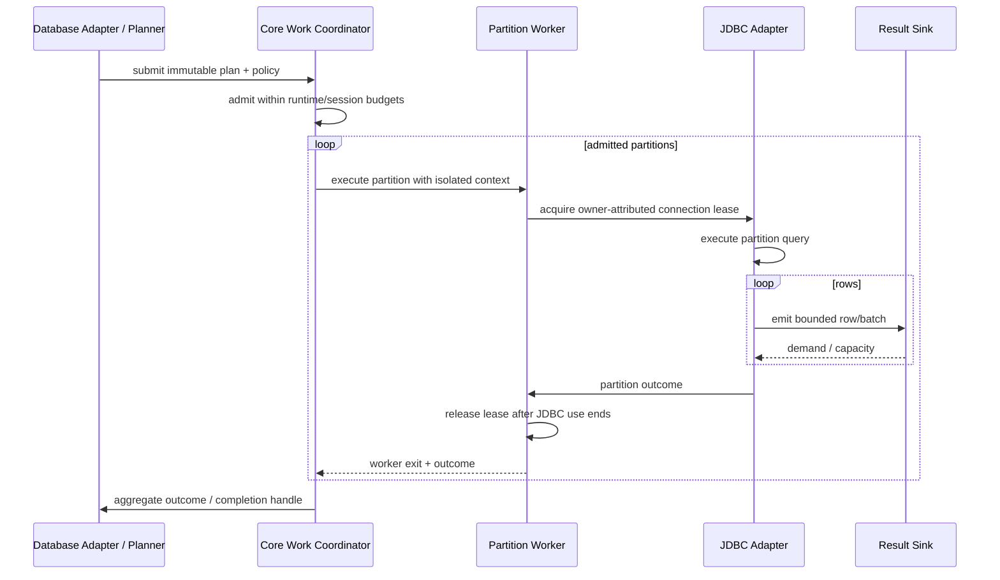
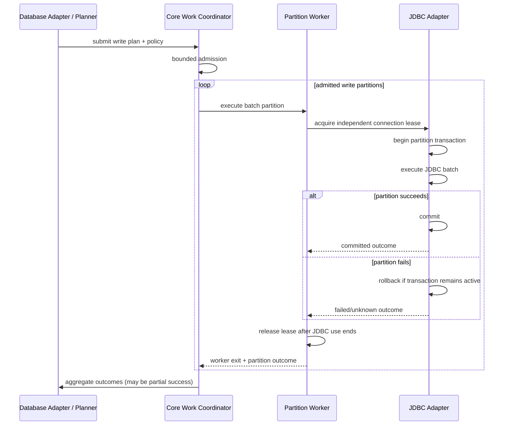

# Execution Architecture RFC: bounded and partitioned work

**Status:** Proposed architecture; no runtime implementation authorized by this document alone  
**Scope:** Core execution contracts and technology adapters, with JDBC as the first consumer  
**Related work:** PR #381 (JDBC resource leases), Issue #382 (DatabasePlugin decomposition)

## 1. Decision

WebHarvest should provide a technology-neutral Core capability for planning and executing bounded units of work. Database/JDBC is an adapter and an early consumer, not the owner of the scheduler or the generic partition execution model.

The immediate architectural goal is to establish stable Core extension points before parallel execution is implemented. This is specifically intended to avoid later migrations of stabilized plugin APIs and runtime lifecycle code.

The existing Maven direction is correct: `webharvest-database` depends on `webharvest-core`; Core must not depend on JDBC, DBCP, vendor drivers, SQL dialects, or database-specific partitioning classes.

## 2. Two distinct workload semantics

### 2.1 Partitioned reads

A logical read may be represented by multiple disjoint or explicitly overlapping work partitions. Strategies may include numeric/date ranges, hash/modulo, explicit SQL predicates, or adapter-defined partitions.

Required semantics to define:
- partition identity and coverage (including gaps/overlaps);
- result ordering: globally ordered, partition ordered, or unspecified;
- bounded streaming/backpressure; avoid mandatory whole-result materialization;
- snapshot/consistency policy across independently executed queries;
- skew detection and optional partition sizing;
- deterministic error and partial-result reporting.

A range split based only on MIN/MAX is not proof of balanced work. The adapter/planner must be able to report unknown distribution and avoid promising balanced execution.

### 2.2 Parallel writes

Writes have different guarantees and must not be treated as the inverse of reads.

Required semantics to define:
- input batching separately from parallel partition execution;
- independent transaction boundaries and commit outcomes;
- partial success, failure aggregation, and retry eligibility;
- idempotency/deduplication contract for retries;
- staging-and-merge as a possible adapter strategy;
- ordering and constraints when writes target related rows or shared keys.

A parallel write is not implicitly one atomic transaction. Core must expose that distinction rather than imply global rollback.

## 3. Proposed Core boundary

The first Core API should be deliberately small, immutable where possible, and independent of SQL and data-source implementation details.

Candidate concepts for API review (names are provisional):
- **WorkPlan** — immutable description of one logical operation and its planned work.
- **WorkPartition** — one independently schedulable unit, with stable identity and opaque adapter-owned payload/descriptor.
- **ExecutionPolicy** — requested/allowed concurrency, ordering, failure behavior, and resource budgets.
- **WorkExecutor** — runtime-owned bounded execution service that accepts a plan and policy.
- **WorkExecution** — handle for observing completion, results/stream, cancellation request, and terminal outcome.
- **WorkResult / PartitionOutcome** — explicit per-partition and aggregate outcomes, including partial success and failures.

The API review must decide whether read-result streaming belongs in a separate sink/consumer contract rather than in a generic result object. Core must not force every workload to materialize a collection.

Do not add a generic workflow DAG, durable distributed job manager, cluster scheduler, SQL planner, or vendor-specific partition classes as part of this first SPI.

## 4. Runtime and lifecycle integration

The execution service must be session/runtime-owned and bounded. It should use a host-provided executor where appropriate, or a runtime-managed bounded executor with explicit ownership and shutdown semantics. It must not create an unbounded thread per partition.

The existing execution lifecycle and resource model are foundational:
- `ExecutionOwner` attributes work to its owning execution.
- `ExecutionResourceAccess` and `ResourceLedger` distinguish resource registration from active-use leases.
- Cancellation/interruption is a request, not proof that a worker exited.
- A resource lease must remain held until the actual operation stops using the resource.
- Quiescence and resource drain may only be declared after worker exit is observed.
- Unconfirmed JDBC cancellation/close must remain visible as failed or quarantined; never report a hard abort without evidence.

The SPI must define how child work is registered with the owning session, how all children are cancelled, how actual worker exit is observed, and how a session waits/drains without releasing resources still in use.

## 5. Context isolation

Do not share a mutable `DynamicScopeContext` across concurrent workers.

Before implementation, define an explicit per-partition execution context:
- immutable/shared read-only inputs where safe;
- isolated local variable scope and result channel;
- explicit propagation of execution owner, cancellation signal, tracing/correlation and resource access;
- deterministic merge rules for outputs;
- no implicit concurrent mutation of session variables.

The existing synchronous plugin contract remains valid. Parallel work should be an opt-in execution capability, not a silent change to the semantics of `Plugin.execute(context)` or `<loop>`.

## 5.1 Executor topology and admission (important implementation constraint)

The current `WebHarvestServiceImpl` default session executor is created with `Executors.newCachedThreadPool`; the service can also receive a host-supplied `ExecutorService`. This is the existing session-execution mechanism, not a safe implicit budget for future partition workers.

Do not simply submit child partitions to the session executor and synchronously wait for them: a bounded shared pool can starve or deadlock when parent session tasks occupy its workers. Conversely, creating a separate fixed-size pool per session multiplies the effective concurrency by the number of sessions and defeats a runtime-wide resource budget.

The SPI design must therefore explicitly decide:
- a runtime-wide bounded partition-work admission budget, distinct from session admission;
- per-session/per-operation sub-budgets so one large session cannot monopolize all workers;
- non-blocking completion/continuation or another starvation-safe coordination model;
- host executor injection and ownership/shutdown semantics;
- queue bounds and rejection/backpressure behavior;
- interaction with JDBC connection-pool limits and other adapter resource budgets.

The contract must not promise a concurrency level that the runtime cannot admit. Effective concurrency is the minimum of requested policy and available runtime/session/adapter budgets. A caller-supplied executor's capacity and ownership must not be guessed.

## 5.2 Context isolation: current implementation is not a worker fork

Inspection of `DynamicScopeContext` and `ScraperContext` confirms that `executeWithinNewContext(Callable)` is a lexical scope operation on the same context instance, not a context clone or concurrent worker fork. `ScraperContext` mutates a shared `scopeStack`, `centralReferenceTable`, and ordinary `HashMap`/stack structures. It must not be used to create parallel partition contexts.

The SPI therefore needs a separately designed context-fork/worker-input contract. It must define which values are shared read-only, which values are copied or isolated, how mutable `Variable` instances are treated, how system/config/session metadata is inherited, and how results are returned without concurrent writes into the parent variable table. Do not add a shallow-copy helper and call it thread-safe without proving the mutability and aliasing rules of the complete variable graph.

## 5.3 Sequence sketches

These diagrams describe intended responsibility and lifecycle boundaries, not implemented behavior.

### Partitioned read

Cancellation path: Core requests cancellation of outstanding workers; JDBC adapters may attempt statement cancellation. The coordinator must still observe each worker's actual exit before marking its owner quiescent and draining its leases. A cancellation request or Future cancellation alone is not worker-exit evidence.

### Parallel write

The aggregate write outcome must not imply a global transaction. A commit whose acknowledgement is lost may have an unknown outcome; retry safety requires an adapter/application idempotency contract.
## 6. Adapter responsibilities

The Core contract owns generic work lifecycle and policy. Adapters own technology-specific planning and execution.

For JDBC, the Database module owns:
- JDBC connection acquisition and pool interaction;
- dialect/capability discovery and safe query construction;
- SQL predicates and partition-boundary discovery;
- statement fetch size, batch size, transaction handling;
- database-specific snapshot/isolation behavior;
- mapping JDBC rows into WebHarvest values or a streaming sink.

Core must not know JDBC `Connection`, `Statement`, `ResultSet`, SQL syntax, or database vendor names.

The same Core execution SPI should later be usable by HTTP/API, file, and other data-source adapters without JDBC dependencies.

## 7. DatabasePlugin boundary

Keep `DatabasePlugin` in `webharvest-database`. It should remain a compatibility-facing XML adapter/orchestrator and delegate to cohesive database services.

Its existing XML contract, named/inline connection behavior, result XML shape, exception precedence, and legacy compatibility must be preserved during decomposition.

The Database module should consume Core execution contracts only after those contracts are reviewed and stable. Do not implement parallel execution inside DatabasePlugin while the Core SPI is unsettled.

## 8. Delivery plan and priorities

| Priority | Work | Gate / outcome |
|---|---|---|
| P0 | Complete and stabilize PR #381 JDBC resource lifecycle | Exact-head required CI green; preserve draft/review gate |
| P1 | DatabasePlugin characterization and behavior-preserving decomposition (#382) | Existing XML behavior and cleanup semantics covered; no speculative parallel engine |
| P1 | Core execution SPI design and lifecycle/context review | Agree public contracts, ownership, cancellation, streaming and compatibility before implementation |
| P2 | Add minimal Core interfaces/value types and contract tests | No JDBC dependencies in Core; no executor implementation required yet |
| P2 | Sequential plan execution through the new SPI (if needed to validate contracts) | Prove contract without introducing concurrency semantics prematurely |
| P3 | JDBC batch writes | First measurable throughput improvement; explicit transaction/partial-failure semantics |
| P3 | JDBC partitioned reads | Bounded concurrency, streaming, partition coverage and consistency policy |
| P4 | Adaptive planning and skew-aware partition sizing | Only after real metrics and multi-database evidence |

P1 activities may be parallelized only where they do not change the same code or destabilize PR #381. The Core SPI must not be hidden inside the DatabasePlugin decomposition.

## 9. Non-goals and guardrails

- No Spark/Sqoop clone and no mandatory distributed runtime.
- No default parallelism for existing XML configurations.
- No unbounded queues, unbounded worker creation, or unbounded result buffering.
- No sharing JDBC connections concurrently unless an adapter/driver contract explicitly supports it.
- No global transaction guarantee across independent write partitions.
- No implicit ordering guarantee for parallel reads.
- No speculative public API proliferation: prefer the smallest stable SPI and document extension compatibility.
- No migration of existing synchronous plugin behavior merely to make it parallel.

## 10. Acceptance criteria for the Core SPI

1. Core has no compile/runtime dependency on JDBC or database modules.
2. API expresses logical plan, partition identity, execution policy, lifecycle handle, and explicit outcomes without exposing adapter internals.
3. Cancellation request, worker exit, quiescence, lease drain, and physical close remain distinct states/events.
4. Each worker has isolated context and explicit owner/resource attribution.
5. Backpressure/streaming is possible without forcing materialization.
6. Partial success and failure aggregation are representable.
7. Read ordering and consistency are explicit policies, not accidental guarantees.
8. Existing synchronous plugin and XML behavior remain unchanged.
9. Contract tests cover bounded admission, cancellation/exit ordering, resource lease retention, isolation, partial failure and deterministic result semantics.

## 11. Current architectural conclusion

The database module boundary is already in the correct direction. The missing piece is not moving JDBC code again; it is introducing the smallest technology-neutral execution SPI in Core before Database and other adapters begin depending on ad-hoc concurrency APIs.

The next implementation step is therefore the Core contract, not a parallel JDBC implementation.