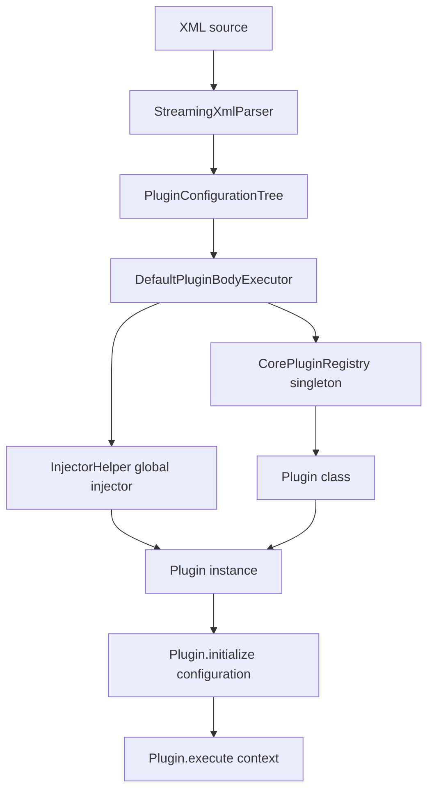
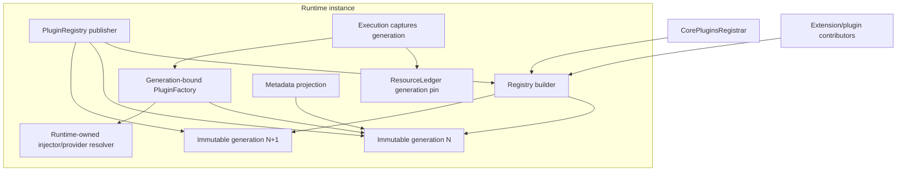
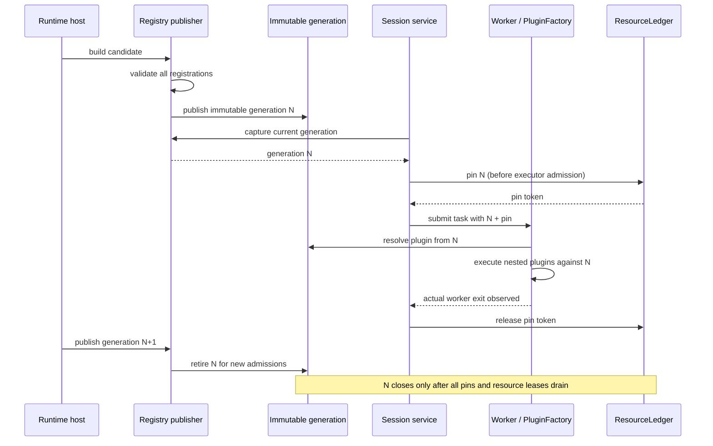

# Plugin Registry Generation Design

**Status:** Proposed architecture decision; implementation intentionally not included.
**Scope:** Core runtime plugin registration, XML element dispatch, plugin construction, metadata projection, and generation ownership required by runtime resource pinning.
**Related work:** [#377](https://github.com/web-harvest/web-harvest/issues/377), [#355](https://github.com/web-harvest/web-harvest/issues/355), [#354](https://github.com/web-harvest/web-harvest/issues/354), [#357](https://github.com/web-harvest/web-harvest/issues/357), [#349](https://github.com/web-harvest/web-harvest/issues/349).

## 1. Decision summary

WebHarvest must have **one runtime-owned plugin registry authority**. It publishes immutable generations. Every execution captures exactly one generation and resolves every plugin through that captured generation.

The candidate direction is to evolve the existing `PluginRegistry` contract rather than introduce a parallel registry family. This choice must be reconciled with the approved descriptor/SPI and Core inventory under #93/#94 before implementation; this document is a review proposal, not permission to bypass those architecture gates:

- `PluginRegistry` becomes the runtime-facing registry/publication API.
- `DefaultPluginRegistry` becomes its implementation, with mutable registration confined to a builder/staging phase and immutable published snapshots.
- `CorePluginsRegistrar` becomes a deterministic contributor of built-in registrations to a registry builder; it must not mutate a process-global singleton.
- `PluginFactory` remains a construction service, not a registry or source of plugin identity. Its runtime resolution methods must operate against a captured generation.
- `PluginMetadataCatalog` remains a read-only metadata projection. It must consume a generation snapshot and must never independently discover or instantiate a second plugin universe.
- `CorePluginRegistry` and `PluginRegistryHolder` are legacy global registry paths. They must be migrated to compatibility facades over an explicitly supplied runtime registry or deprecated and removed after call-site migration. They must not remain independent authorities.
- Static/global `InjectorHelper` resolution is not a valid generation-scoped construction mechanism. The runtime-owned composition boundary must supply the injector/provider used by the generation. This work coordinates with #357.

This is a proposed migration target, not authorization to change public compatibility behavior without characterization tests.

## 2. Source-confirmed current architecture

Inspection of `main` found multiple competing mechanisms with different responsibilities and lifetimes.

| Mechanism | Current behavior | Architectural classification |
|---|---|---|
| `ElementsRegistry` / `ElementsRegistryImpl` | Legacy `ElementName -> ElementInfo` metadata registry; no active production registration/lookup call site found in targeted Core source inspection | Orphaned XML metadata infrastructure; retire after repository-wide and external-usage audit, do not treat as executable dispatch |
| `CorePluginRegistry` | Process-wide singleton mapping XML element names to plugin classes; mutable map; `clear()` | **Actual XML dispatch registry today** |
| `CorePluginsRegistrar` | Static synchronized registration into `CorePluginRegistry.getInstance()`; one static `initialized` flag; invoked from `ScraperModule.configure()` | Global bootstrap mutator, not a runtime-owned publication |
| `PluginPackageScanner` | Opt-in package scanner that also mutates a supplied `CorePluginRegistry`; not wired by default `ScraperModule` | Optional registration path into the same global dispatch registry, not an independent publication lifecycle |
| `PluginRegistry` / `DefaultPluginRegistry` | Separate registration API and mutable maps for plugin instances, classes, metadata, namespace/element lookup | Parallel registry API; not the core XML dispatch authority |
| `PluginRegistryHolder` | Separate process-global singleton; classpath scans and registers annotated core plugins into `DefaultPluginRegistry` | Second global bootstrap path |
| `PluginFactory` / `DefaultPluginFactory` | Constructs plugin instances; ID/namespace lookup is delegated to injected `PluginRegistry` | Construction facade coupled to the parallel registry |
| `PluginMetadataCatalog` | Static initialization scans classes and instantiates plugins to build descriptors | Independent metadata discovery/projection; not a runtime registry |
| `StreamingXmlParser` | Creates `PluginConfigurationTree` nodes with `pluginClass == null`; resolver lookup is commented out | Parser currently does not bind a plugin registry generation |
| `DefaultPluginBodyExecutor.createChildPlugin()` | Looks up the class from global `CorePluginRegistry`, then obtains instances through static `InjectorHelper.getInjector()` (reflection fallback) | **Actual execution-time dispatch and construction path** |

Important consequence: a design centered only on `PluginRegistryHolder` or `PluginMetadataCatalog` would miss the current execution path. Conversely, simply extending `CorePluginRegistry` would leave the separate `PluginRegistry` API, factory, and metadata scanner as competing sources of truth.

The generation design must unify these paths deliberately.

## 3. Current execution path (source evidence)

Observed source details:

- `StreamingXmlParser.ConfigurationTreeHandler.startElement()` currently leaves `ElementInfo` null, creates a configuration node, and sets its `pluginClass` to null. The source contains a TODO to replace the old resolver with direct registry lookup.
- `DefaultPluginBodyExecutor.createChildPlugin()` calls `CorePluginRegistry.getInstance().getPluginClass(elementName)`, then `InjectorHelper.getInjector()`; if no injector is available it falls back to reflective construction.
- `ScraperModule.configure()` invokes `CorePluginsRegistrar.registerCorePlugins()` and requests static injection of `InjectorHelper`; the registrar populates the singleton with 44 built-in XML element mappings and protects initialization with a static flag.
- `PluginPackageScanner` can add explicitly scanned `@CorePlugin` classes to a supplied `CorePluginRegistry`, but the default `ScraperModule` does not wire/invoke it. Optional scanning is therefore a distinct opt-in path, not evidence of an automatically unified extension lifecycle.
- `PluginRegistryHolder.getInstance()` independently creates a `DefaultPluginRegistry` and scans `@CorePlugin` classes.
- `DefaultPluginFactory` resolves plugin IDs and namespace/element pairs through an injected `PluginRegistry`, not `CorePluginRegistry`.
- `PluginMetadataCatalog` has a static catalog build path using `PluginClassScanner` and reflective plugin construction.

The 44 XML mappings include executable plugins and declarative/parent-consumed XML nodes. The published registry descriptor must preserve that distinction; presence in the XML mapping table does not imply independent executable capability. See [CORE_PLUGIN_RUNTIME_EVIDENCE.md](CORE_PLUGIN_RUNTIME_EVIDENCE.md).

## 4. Target architecture

### 4.1 Registry publication

A runtime-owned publisher accepts a fully validated candidate and atomically publishes an immutable generation. The generation owns:

- a unique `RegistryGenerationId` issued by the runtime at publication;
- immutable lookup maps for XML element, plugin ID, namespace/element, and class identity as required by supported compatibility APIs;
- immutable plugin descriptors and registration metadata;
- the exact plugin implementation classes and the provider/injector/class-loader ownership needed to construct them;
- lifecycle state and retirement coordination.

A generation is not just a map of class names. It must represent the exact resolution and construction universe used by its sessions.

A failed candidate build must not alter the currently published generation. Publication is a single atomic swap after all registrations, duplicate checks, dependency checks, and provider setup succeed.

### 4.2 Session capture and resolution

At execution admission, the runtime captures the currently published generation and obtains its generation pin before executor submission. The task carries that captured generation through all nested plugin execution. Resolution never consults a mutable global registry again.

The XML parser remains concerned with syntax/configuration. It must not race a registry publication or resolve a class from a different generation than the executing session. The parsed configuration tree can remain class-neutral; runtime dispatch uses the captured generation.

### 4.3 Construction

`PluginFactory` is retained as the construction abstraction. It receives a generation-bound resolution context and a runtime-owned construction provider. It must not resolve IDs through a different mutable registry or use process-global injector lookup.

The factory must preserve existing constructor and Guice injection behavior through an explicit compatibility adapter while the runtime-owned composition boundary is migrated. Reflective fallback must be an explicit, tested policy rather than an invisible fallback that can bypass runtime ownership.

### 4.4 Metadata

`PluginMetadataCatalog` becomes a projection over a specific immutable generation. It does not scan the classpath, instantiate plugins, or maintain its own static descriptor universe during normal runtime operation.

If tooling needs metadata before a runtime is created, it may use a separate discovery/build pipeline that produces a candidate registry generation. That pipeline must publish through the same validation and descriptor rules; it is not a second runtime registry.

### 4.5 Retirement

When a new generation is published, the previous generation becomes retired for new admissions. Existing sessions that already pinned it may continue resolving and using its providers. The old generation is closed only after:

1. no new pin can be acquired;
2. all session generation pins are released after confirmed worker exit;
3. all operation/resource leases are drained;
4. owned provider/injector/class-loader close actions complete.

A timeout or unresponsive worker retains/quarantines the generation; it does not release ownership. This composes with #354 and #355.

## 5. Lifecycle and concurrency

Required race outcomes:

- **Submit vs publish:** each execution captures exactly one fully published generation.
- **Submit vs retire:** pin acquisition and retirement have one atomic winner; no admission can use a retired generation without a pin.
- **Queued cancellation:** release only after confirmed task removal/no-entry, or after the task body observes cancellation and exits.
- **Running cancellation:** release only after actual worker exit is observed.
- **Unresponsive worker:** retain the pin and quarantine resources/generation.
- **Multiple runtimes:** generation identity and publication/retirement state are runtime-scoped; runtime A cannot retire runtime B's generation.

## 6. Migration map (no parallel replacement mechanisms)

| Existing component | Target treatment |
|---|---|
| `PluginRegistry` | Evolve as the one canonical runtime registry/publication API |
| `DefaultPluginRegistry` | Implement candidate building and immutable generation publication; mutable maps never escape a build/published snapshot |
| `CorePluginRegistry` | Remove process-global ownership; temporary compatibility facade delegates to an explicitly supplied generation/runtime registry |
| `CorePluginsRegistrar` | Register built-ins into the canonical builder; remove static initialized flag and singleton mutation |
| `PluginPackageScanner` | Convert discovery output into candidate contributions to the canonical builder; discovery must not publish/mutate a live generation directly |
| `PluginRegistryHolder` | Deprecate/remove process-global holder after call-site migration; compatibility path must not instantiate a second registry |
| `PluginFactory` | Keep as construction API; all lookups require the captured generation |
| `DefaultPluginFactory` | Construct from generation-bound resolver and runtime-owned provider; no mutable registry lookup during execution |
| `PluginMetadataCatalog` | Immutable projection from a generation; remove static independent discovery in runtime use |
| `PluginClassScanner` | Retain only as an explicit candidate discovery input if needed; never as a parallel published registry |
| `StreamingXmlParser` | Keep class-neutral; remove stale resolver/POC comments when dispatch integration is complete |
| `DefaultPluginBodyExecutor` | Require an execution-bound generation/factory; remove global `CorePluginRegistry` and `InjectorHelper` lookups |
| `InjectorHelper` | Migrate as part of runtime composition/isolation (#357); no hidden global injector in generation-scoped plugin creation |

This map is a target, not a claim that every listed class can be removed immediately. Public API compatibility and extension behavior require characterization before deprecation/removal.

## 7. Compatibility and semantic constraints

- Preserve all 44 current core XML mappings, including legacy `set-var`, and preserve distinctions between executable plugins and declarative/parent-consumed nodes.
- Do not infer that every `@CorePlugin` class is a valid standalone XML dispatch mapping.
- Preserve plugin ID and namespace/element lookup semantics only where existing public API contracts require them; test collisions and precedence explicitly.
- Define duplicate ID, duplicate XML element, duplicate namespace/element, and alias behavior before publication.
- Avoid constructing plugin instances during catalog enumeration merely to read metadata.
- Do not share mutable plugin instances between sessions unless the plugin contract explicitly declares and tests that behavior. Generation ownership of classes/providers is distinct from per-invocation plugin instances.
- A class-loader/provider must not be closed while any pinned session or operation lease can still use it.
- Metadata schema version is not a generation identity. A content hash alone is not a lifetime identity.

## 8. Required implementation slices

1. **Characterization:** inventory every production and test call site of all registry/factory/catalog/singleton mechanisms; identify public API and extension compatibility contracts.
2. **Registry model:** define immutable generation, runtime-scoped ID, candidate builder, duplicate validation, atomic publication, and retirement API.
3. **Bootstrap unification:** route built-in registration and extension contributions through one builder; stop static singleton registration.
4. **Execution binding:** capture generation before task admission; pass it through session context and nested plugin execution.
5. **Construction isolation:** bind PluginFactory and provider/injector to the captured generation and runtime.
6. **Metadata projection:** derive catalog descriptors from the same published generation.
7. **Resource integration:** connect generation pins to #355 only after #354 worker-exit guarantees are verified.
8. **Legacy retirement:** deprecate/remove global holders and duplicate registries after compatibility tests pass.

Each slice must have focused tests and full Core/reactor quality gates. No step should merge on the basis of compilation alone.

## 9. Acceptance test matrix

| Area | Required deterministic test |
|---|---|
| Publication | Invalid candidate leaves the current generation unchanged |
| Identity | Two generations with identical metadata but distinct provider lifetimes have distinct IDs |
| Snapshot | Published maps/descriptors cannot be mutated by callers |
| Resolution | A session continues resolving from its captured generation after a newer publication |
| Duplicate rules | Duplicate IDs, element names, aliases, and namespace/element pairs fail deterministically |
| Admission race | Latch-controlled publish/capture/pin race has exactly one valid outcome |
| Retirement race | No new pin succeeds after retirement wins |
| Queued cancellation | Pin remains until confirmed no-entry/removal |
| Worker exit | Pin remains until actual exit, not merely terminal business status or Future cancellation |
| Quarantine | Non-cooperative worker prevents generation/provider close |
| Runtime isolation | Runtime A cannot resolve, pin, or retire runtime B's generation |
| Factory | All factory lookup paths resolve against the captured generation |
| Metadata | Catalog is derived from generation and does not independently instantiate/scan a second runtime registry |
| Compatibility | Existing public registry/factory APIs preserve documented behavior or have explicit migration tests |
| XML compatibility | All 44 mapping rows remain valid with declarative-node distinctions preserved |

## 10. Explicit non-goals

- No new competing `PluginRegistryV2`, `PluginManager`, `PluginCatalogRegistry`, or parallel factory hierarchy.
- No runtime implementation in this design-only change.
- No change to XML syntax, plugin semantics, or the 44 compatibility mappings.
- No claim that Java thread interruption can hard-kill a plugin.
- No integration of resource pins using fabricated generation IDs.
- No premature deletion of public legacy APIs without compatibility evidence.

## 11. Verification boundary

This document is based on source inspection of `main`. It does not claim that the target design has been implemented, tested, or approved by CI. Implementation remains gated by #93/#94 (Core inventory and descriptor/SPI approval), #377 (generation ownership), #349 (activation/lifecycle policy), and the dependent execution/resource contracts.

## 12. Historical XML element metadata and ElementsRegistry retirement

### 12.1 Correct responsibility classification

`ElementsRegistry` is not an executable plugin registry and must not be mechanically merged into `CorePluginRegistry`, `PluginRegistry`, or a plugin factory.

The current source shape is:

- `ElementsRegistry` is a thin interface extending the generic `Registry<ElementName, ElementInfo>`.
- `ElementsRegistryImpl` delegates all storage behavior to `AbstractRegistry`.
- `ElementName` represents an XML name/namespace pair. Its fields are non-final (there are no public setters), and its equality/ordering implementation is not a suitable canonical identity contract for a new runtime: it implements raw `Comparable`, and its constructor permits a null namespace URI even though `equals()` and `compareTo()` dereference that URI. It is also used by the legacy `XmlNode` tree as the key for child-element indexes and in public child-lookup methods.
- `ElementInfo` contains historical XML grammar and editor/validation metadata: permitted/required child names, permitted/required attributes, namespace-family attribute rules (`p:*` and `v:*`), suggested attribute values, internal-element markers and dependent-processor metadata.
- The old definition/processor class fields were removed, while the constructor still accepts class arguments and the corresponding getters return `null`. The remaining value collections and arrays are exposed as mutable references.

This metadata is valuable historical behavior. The old registry and mutable value objects are not an appropriate target architecture.

The distinction matters because the actual current XML execution dispatch path is separately represented by `CorePluginRegistry` and `DefaultPluginBodyExecutor`. A registry unification that only replaces `CorePluginRegistry` would leave XML grammar/validation metadata as a separate legacy subsystem; a mechanical merge of `ElementsRegistry` into plugin dispatch would incorrectly imply that every XML grammar node is an executable plugin.

### 12.2 Current parser qualification

The current `StreamingXmlParser` source has the old resolver/ElementInfo lookup commented out. Its handler assigns `elementInfo = null`, creates a `PluginConfigurationTree` node without a plugin class, and describes the fallback as a POC. Consequently, the current parser path does not consume the old `ElementsRegistry` metadata to validate the parsed tree.

The existing `ConfigParser` abstraction is also incomplete, and the current `XMLConfig.reload()` behavior is tied to a concrete parser implementation. The XML migration therefore needs to restore a real parser contract, not simply reconnect the old registry.

The existing `ElementInfoContractTest` currently protects required child/attribute markers, namespace wildcards, enumerated attribute values, internal markers and XML template generation. It is characterization evidence for the metadata vocabulary, not proof that the default parser currently applies these rules. `XmlNodeContractTest` covers same-namespace child lookup, attribute/text behavior and serialization round-tripping through `ElementName`. The current test tree has no dedicated `ElementsRegistry` contract test and does not characterize null-namespace `ElementName` equality/ordering. `XmlNode` has its own focused contract tests and must be included in the replacement inventory.

These are source observations, not proof that every historical XML validation behavior is currently exercised by the default parser. The complete production/test call-site and historical behavior inventory remains a required characterization task.

### 12.3 Target: one generation, separate typed projections

The runtime generation should own one coherent, immutable XML/plugin semantic snapshot, with distinct typed projections:

1. **Plugin descriptors** describe executable providers, construction contracts, capabilities, plugin configuration schemas and lifecycle.
2. **XML element descriptors** describe the accepted XML grammar, element identity, dialect applicability, child/attribute constraints, defaults, aliases, and whether an element is executable, declarative/parent-consumed, or compatibility-only.
3. **XML dialect descriptors/adapters** define historical parsing and normalization semantics for each supported XML format/version.

These are not three independently mutable registries. They are typed indexes and projections built and validated together, then published atomically as part of one immutable runtime generation. A declarative XML node may have an XML element descriptor without having a plugin provider. An executable plugin descriptor may reference one or more XML element identities and aliases.

Names such as `XmlElementDescriptor`, `XmlDialectDescriptor`, and `XmlElementCatalog` are conceptual only; final Java API names must follow the completed source inventory and descriptor/SPI review. Do not introduce an `ElementsRegistryV2` or another independently mutable registry.

### 12.4 Metadata migration rules

Migrate the semantics of `ElementInfo` into immutable, defensively copied descriptor data:

- allowed and required child expanded names;
- allowed and required attributes;
- namespace-family attribute rules;
- suggested/enum attribute values;
- internal and parent-consumed markers;
- dialect-specific defaults and normalization rules;
- source/documentation metadata where useful to diagnostics and tooling.

Use an immutable expanded XML name value (namespace URI + local name); do not reuse mutable `ElementName` as the canonical identity. Do not retain `Class<?>` references in parsed configuration nodes or XML grammar descriptors. Provider binding belongs to the plugin descriptor/factory projection for a pinned generation.

### 12.5 XML front-end pipeline

The target XML path is:

1. Parse XML syntax into a parser-neutral, namespace-aware syntax tree that preserves text, qualified attributes, namespace declarations and source locations.
2. Select the historical dialect adapter using explicit version/namespace/root rules.
3. Apply that dialect's exact name, attribute, text, alias and default semantics.
4. Validate the normalized syntax tree against immutable XML element descriptors in the selected runtime generation.
5. Produce a class-neutral canonical configuration tree/AST.
6. Resolve executable nodes through the plugin descriptors and generation-bound factory at execution/plan time; retain declarative nodes as configuration consumed by their parent.

The parser implementation must return the same canonical model through the `ConfigParser` contract. `XMLConfig` must not branch on `instanceof StreamingXmlParser`. Parsing/normalization must not consult a process-global registry or a different generation from the one selected for validation and execution.

### 12.6 Retirement decision

The intended end state is to replace and retire `ElementsRegistry`, `ElementsRegistryImpl`, `ElementInfo` and `ElementName` as the authoritative XML metadata model after their required semantics have been characterized and migrated.

A temporary compatibility adapter may be used only where a verified caller requires it during migration. It must delegate to an explicitly supplied immutable generation/dialect view and must not create another registry authority. Java API compatibility alone is not a reason to preserve the old classes; the mandatory compatibility boundary is the historical XML behavior.

### 12.7 Additional acceptance tests

- Every historical XML dialect fixture is parsed and normalized through the same parser contract.
- Child/attribute requiredness, namespace-family attributes, suggested values and internal-node behavior match characterized historical semantics.
- Namespace URI + local name identity, aliases and dialect-specific name collisions are deterministic.
- Declarative/parent-consumed nodes are accepted and represented without requiring a plugin implementation.
- Executable nodes resolve only through the pinned generation's plugin descriptor/factory.
- Parser output contains no implementation `Class<?>` binding and is independent of the concrete parser implementation.
- Invalid XML metadata candidates fail before publication and leave the last-known-good runtime generation unchanged.
- The old `ElementsRegistry` API has no production authority after migration; any temporary adapter is covered by explicit compatibility tests.
- `XmlNode` child indexing and lookup behavior is preserved or deliberately replaced by an equivalent immutable expanded-name index; all `ElementName` consumers are migrated before the old value type is removed.
- Null/empty namespace URI behavior is explicitly characterized and tested; the current `ElementName` constructor permits null URI while `equals()` and `compareTo()` dereference it.
- The migration adds explicit registry publication/lookup tests rather than assuming the generic `AbstractRegistry` tests characterize XML metadata semantics.

## 13. Configuration scopes and secret references

Plugin registry generations must reference configuration contracts, not absorb configuration ownership into the registry. WebHarvest configuration has distinct lifetimes and must not be represented by one untyped map.

The required conceptual scopes are:

| Scope | Lifetime / owner | Responsibility |
|---|---|---|
| Runtime variables | One execution and its nested scopes | Dynamic values produced/read/updated while a flow executes |
| Plugin instance configuration | One plugin instance or configured component | Typed initialization inputs validated against its descriptor schema |
| Global parameter context | A named host/application/environment context, captured as a versioned snapshot | Reusable values shared by flows and plugin instances |
| Secret provider | External or host-owned security boundary | Resolve sensitive references under an explicit access context |

Global parameters are analogous in purpose to Apache NiFi Parameter Contexts, but the WebHarvest model must define its own lifecycle, scoping, versioning and security behavior.

A global parameter context should be versioned and immutable once captured by an execution/configuration revision. References should be stable keys rather than copied values. Precedence/overrides (if supported) must be explicit and deterministic; ambient environment variables must not silently override declared configuration.

Plugin descriptors should declare typed configuration requirements and validation rules. A plugin instance receives its resolved, validated configuration through its creation context. It must not reach into a process-global parameter singleton or query a Vault implementation directly.

Runtime variables remain execution data. They are not global configuration, must not be implicitly persisted as parameter values, and must preserve existing expression/variable semantics unless a separately reviewed migration changes them.

### 13.1 Secret references are not ordinary parameter values

A global parameter may contain a typed secret reference, but secret material must remain under a separate provider boundary. For example, a configuration may refer to a logical secret such as `vault://services/weather/api-key`; this is illustrative syntax, not a frozen URI scheme or API.

The model must distinguish:

- ordinary literal parameter values;
- secret references and provider identity;
- resolved secret material/credential handles;
- certificates, private keys and other typed credential material that should not be coerced into ordinary strings.

Secret values must not be serialized into DSL/configuration exports, metadata catalogs, diagnostics or logs. Resolution must be authorized and auditable, and secret exposure should be minimized. APIs should avoid requiring immutable `String` values for secret material where a safer representation is practical.

### 13.2 Provider architecture

Define a neutral secret-resolution port and access context. Provider implementations may later support environment-backed values, protected local files, operating-system credential stores, HashiCorp Vault or other external secret managers. No specific provider or Vault dependency is required by Core.

The provider boundary must account for:

- explicit provider selection and reference validation;
- runtime/host identity and least-privilege access;
- redaction and safe diagnostic behavior;
- secret rotation and revocation;
- typed credentials/certificates as well as scalar tokens;
- offline operation and host-supplied providers;
- deterministic failure behavior when a provider is absent or access is denied;
- explicit resolution/rotation consistency semantics for a running execution.

Do not assume that a secret's plaintext should be copied into an immutable parameter snapshot. The snapshot should normally pin the reference and policy; whether resolution uses the latest value or a specific provider version must be an explicit policy decision. Rotation must not silently change a credential midway through an operation.

### 13.3 Ownership boundaries

- The runtime owns the parameter-context snapshot associated with an execution/configuration revision.
- The plugin factory supplies each plugin instance with its declared, validated configuration.
- The host/runtime supplies secret-resolution capability and access context.
- A plugin receives only the secret or credential capability it needs; it does not receive unrestricted access to every global parameter or secret.
- The registry generation may carry descriptor schemas and required capability declarations, but it does not store secret material or own a Vault client.

### 13.4 Design and implementation gates

Before implementation, characterize existing variable interpolation, `PluginConfiguration`, configuration loading, XML parameter/variable namespaces and plugin initialization. Then define versioning, scope visibility, override rules, expression evaluation order, secret reference semantics and failure behavior.

Acceptance must cover two independent runtimes with different parameter contexts/providers, execution snapshot consistency, nested runtime-variable scope behavior, plugin schema validation, secret redaction, denied/missing providers, rotation policy and absence of secret material from serialized DSL and logs.

This section records architectural requirements only. It does not claim that global parameter contexts, a Vault integration, or a new secret store are implemented.

## 14. Runtime reality check — the legacy ElementsRegistry is not the active dispatch path (2026-11-27)

A further source inspection changes the migration framing in an important way:

- The production Core source has no active registration or lookup call site for `ElementsRegistry` / `ElementsRegistryImpl`. The interface and implementation remain as isolated legacy types; the current runtime does not populate them.
- `ElementInfo` is referenced by `StreamingXmlParser`, but only as a local variable assigned `null`. The former resolver field and lookup are commented out. Its class/processor getters also return `null`; the corresponding fields were removed.
- `ElementName` remains used by the legacy `XmlNode` child index and lookup API. This is a separate residual dependency from the registry interface itself.
- Actual executable dispatch currently goes through the singleton `CorePluginRegistry`: `CorePluginsRegistrar` manually registers local element-name strings, and `DefaultPluginBodyExecutor` resolves child plugins using only `childConfig.getElementName()`.
- `StreamingXmlParser` does not resolve a descriptor or plugin. It creates every XML node with a null `pluginClass`; the executor later performs local-name-only dispatch. The comments explicitly describe this as a POC/fallback and defer direct registry lookup.

**Design consequence:** do not mechanically "replace ElementsRegistry" as if it were the active runtime registry, and do not port the old registry API into the new platform. Treat it as dead/orphaned legacy infrastructure to retire after a repository-wide production/test/reference and external-usage check. Mine `ElementInfo` only for historical grammar semantics that are independently evidenced and still required. The authoritative future source must be versioned plugin descriptors plus explicit XML grammar/compatibility entries, not an automatically migrated copy of the old mutable registry.

### 14.1 XML namespace information is currently lost at dispatch/attribute boundaries

Two concrete parser/dispatch constraints were confirmed:

- Element namespace is normalized and stored in `DefaultPluginConfiguration`, but `DefaultPluginBodyExecutor` dispatches using only the local element name. The current `CorePluginRegistry` is also keyed only by local element name. Two providers using the same local name in different namespaces cannot be distinguished by this path.
- `StreamingXmlParser.extractAttributes()` reads SAX `getLocalName()` and value, but does not retain each attribute's namespace URI or qualified name. Namespaced attributes sharing a local name can overwrite one another in the resulting `Map<String,String>`; the `p:*` and `v:*` distinction described by legacy `ElementInfo` metadata is not represented in this map.

The future XML boundary must preserve expanded names (`{namespace URI}localName`) for elements and attributes before any compatibility normalization. Plugin dispatch, aliases and attribute binding must be namespace-aware and deterministic. Historical unqualified attributes and namespace-family rules require explicit fixtures/tests; do not infer their behavior from the current lossy map.

### 14.2 The current parser test suite is a happy-path POC, not a compatibility characterization

The current `StreamingXmlParserTest` covers basic/nested/multiple elements, text content and a loop/body tree shape. It does not characterize:
- namespace-aware element dispatch or collisions across namespaces;
- namespaced attribute preservation, including `p:*` / `v:*`;
- unknown element rejection, descriptor lookup, or allowed/required child and attribute validation;
- historical 1.0 namespace aliases and unqualified-root behavior as a full compatibility matrix;
- XML security features (DTD/external entity policy) for the runtime parser.

The parser creates a namespace-aware SAX factory but does not set explicit secure-processing/DOCTYPE/external-entity restrictions in the inspected implementation. This needs a separate security characterization before replacing the parser; it is not safe to assume that the hardened settings in the unrelated `XSDMetadataParser` also apply here.

These gaps are characterization work, not permission to change parser behavior before historical XML fixtures and expected semantics are inventoried.

## 15. Residual XML model and compatibility inventory (2026-11-27)

The `XmlNode` / `ElementName` relationship must not be mistaken for the current XML configuration parser:

- `StreamingXmlParser` builds `PluginConfigurationTree`; it does not construct `XmlNode`.
- Current XML result handling uses `NodeVariable` and `XmlNodeWrapper` around Saxon/XQuery nodes. `XQueryPlugin` has a stale `XmlNode` import in the inspected source, but no use of the type was found in that file.
- The legacy `XmlNode` class is `Serializable`, maintains a separate ordered element/text list and a child index keyed by `ElementName`, and has custom serialization hooks that flush pending text. Its contract test covers child lookup and serialization round-trip.
- No active production call site for `ElementsRegistry` or `XmlNode` was identified in the targeted Core source inspection. This is a targeted finding, not yet a complete all-module/external-consumer proof.

Before deleting `XmlNode` / `ElementName`, complete the repository-wide call-site and serialized-data audit. If no supported consumer exists, retire both rather than preserving a parallel XML tree model. If a consumer is found, migrate it to an immutable expanded-name value type and preserve only the semantics actually required. The explicit product compatibility requirement remains historical XML document behavior, not arbitrary Java serialization of internal tree objects; any persisted serialized data discovered in the audit must be surfaced as a separate decision.

### 15.1 Namespace and alias characterization matrix

The current `StreamingXmlParser.normalizeNamespace()` behavior is narrow:
- empty/null element namespace maps to the 1.0 Core namespace;
- the canonical 1.0 namespace and the historical SourceForge 1.0 URI map to the canonical 1.0 URI;
- other namespace URIs pass through unchanged.

The current `ElementAliasTable` is a Stage-1 local-name-only map and defaults to empty. It is not yet a QName alias policy. The final descriptor/compatibility contract must explicitly define whether aliases are scoped by namespace and how collisions are rejected; never allow a local-name alias to cross namespace boundaries implicitly.

Required historical XML characterization fixtures:
1. no namespace / empty namespace root and descendants;
2. canonical 1.0 Core namespace;
3. historical SourceForge 1.0 namespace URI;
4. canonical 2.1 Core namespace;
5. unknown namespace with a known local element name;
6. same local element name in two distinct namespaces;
7. namespaced parameter and variable attributes, including same-local-name collisions;
8. unqualified attributes alongside namespaced attributes;
9. executable nodes versus parent-consumed/declarative nodes (`http-header`, `http-param`, `stylesheet`, `xq-expression`, `xq-param`, and other evidenced cases);
10. invalid/unknown elements and invalid required/allowed child/attribute combinations;
11. parser security cases: DOCTYPE, external general entities, external parameter entities and external schema access.

The test oracle for each fixture must be the historical meaning and execution result, not simply the current parser's output.

## 16. Repository-wide audit boundary — module inventory (2026-11-27)

The root Maven reactor on `main` declares these nine modules:

| Module | Role relevant to this audit | Call-site status |
|---|---|---|
| `webharvest-core` | XML parser, plugin execution, legacy XML model and registry implementations | Targeted source inspection completed; findings above |
| `webharvest-cli` | Host/client composition and possible external use of Core XML/runtime types | Not yet exhaustively searched |
| `webharvest-ide` | Editor, import/export, configuration and possible serialized-model consumers | Not yet exhaustively searched |
| `webharvest-database` | Optional plugin configuration and XML examples | Not yet exhaustively searched |
| `webharvest-ftp` | Optional plugin configuration and XML examples | Not yet exhaustively searched |
| `webharvest-mail` | Optional plugin configuration and XML examples | Not yet exhaustively searched |
| `webharvest-webbrowser` | Optional plugin configuration and XML examples | Not yet exhaustively searched |
| `webharvest-zip` | Optional plugin configuration and XML examples | Not yet exhaustively searched |
| `docs` | Historical XML examples, versioned references and generated documentation inputs | Historical fixtures/examples inventory still required |

The module list is taken from the root reactor POM; module responsibilities and dependency boundaries are described in `docs/MONOREPO.md`. This table deliberately does **not** convert a targeted Core scan into a repository-wide absence claim.

The GitHub code-search connector did not return usable matches for the legacy type names during this pass. That is a search-index limitation, not evidence that the names are absent. The remaining audit must use a checkout or another exhaustive repository-content mechanism and record exact matches by module, path, symbol, production/test/resource status and whether the reference is executable, reflective, serialized or documentary.

### Required closure evidence

Before retiring `XmlNode`, `ElementName` or any legacy XML type, the audit artifact must include:

1. All source references in every reactor module, including imports, declarations, method signatures, reflection strings and generated-source inputs.
2. All test references and fixtures, classified separately from production consumers.
3. All resource/documentation references, including historical XML examples and versioned docs.
4. IDE/CLI import, export, persistence and serialization paths that may consume or emit the legacy model.
5. A repository search for Java serialization usage and persisted `XmlNode` payloads; absence of an in-repository writer is not proof that external consumers never persisted the type.
6. A compatibility disposition for every non-Core consumer: migrate, preserve behind an adapter, or retire with an explicit compatibility note.

Until this evidence exists, the defensible decision is limited: `ElementsRegistry` is not the active Core dispatch authority in the inspected path; its repository-wide and external-use retirement gate remains open.

## 17. Legacy metadata value-object limitations — direct source inspection (2026-11-27)

Direct inspection of the legacy definitions in `webharvest-core/src/main/java/org/webharvest/definition/` confirms that these classes are not suitable as immutable generation descriptors:

- `ElementsRegistry` is only `Registry<ElementName, ElementInfo>`; `ElementsRegistryImpl` adds no XML-specific behavior and delegates to `AbstractRegistry`.
- `ElementInfo` parses comma-separated child/attribute declarations in its constructor. The legacy `p:*` and `v:*` markers are converted to namespace URI strings in a set, while ordinary attribute names and suggested values are stored separately. Its element identity is only the local `name`; namespace and dialect are not part of this metadata object.
- The old `definitionClass` and `processorClass` constructor arguments are ignored, their fields are commented out, and both getters return `null`. These are historical API remnants, not viable provider bindings.
- `ElementInfo` returns its mutable sets, the internal suggested-value array, and the dependent-processor array directly. It therefore does not provide defensive immutable metadata suitable for atomic generation publication.
- `ElementName` stores `name` and `uri`, but its `equals()` and `compareTo()` dereference `uri`; the constructor permits a null URI. Null-URI equality/order behavior is therefore unsafe and needs an explicit characterization test if compatibility requires it.
- `XmlNode` is independently `Serializable`, stores an ordered `List<Serializable>` plus a child index keyed by `ElementName`, and has custom `writeObject/readObject` hooks. Its serialization behavior is a separate compatibility question from historical XML document compatibility.

These findings strengthen the retirement direction: migrate the useful grammar semantics into immutable, namespace-aware descriptor values, not the mutable `ElementInfo` object graph or its historical constructor/API shape. They do **not** close the all-module or external serialized-data audit in section 16.

## 18. XML compatibility is a grammar contract, not registry compatibility — current runtime evidence (2026-11-27)

The existing `docs/CORE_PLUGIN_RUNTIME_EVIDENCE.md` records the exact 44 XML element mappings registered by `CorePluginsRegistrar`, with corresponding runtime/test evidence. This inventory is the compatibility baseline to preserve or explicitly deprecate; it is not a requirement to retain the old registry classes.

### Compatibility distinctions that the replacement model must encode

1. **Registered executable mappings:** preserve the 44-name mapping set as the current baseline, subject to explicit later Core/optional-module classification. Do not silently drop a name because its implementation is not a standalone capability.
2. **Declarative/parent-consumed XML nodes:** distinguish executable plugin descriptors from configuration-node descriptors. In particular:
   - `stylesheet` is read by the XSLT parent as stylesheet content;
   - `xq-expression` supplies the XQuery expression;
   - `xq-param` supplies typed parameter configuration whose value children are consumed by the parent;
   - `http-header`, `http-param`, regexp child nodes and similar structures are parent-level grammar, not automatically independent processors.
3. **Dual-use XML nodes:** `xml` has a standalone runtime behavior and is also consumed declaratively by transformation parents. A single descriptor can express multiple roles only if those roles remain explicit and validated.
4. **Legacy alias:** `set-var` remains an explicit registered compatibility mapping. `var` is not one of the 44 default mappings; its deprecated class/metadata visibility must not be mistaken for default runtime registration. Preserve `set-var` unless a separately approved deprecation/removal plan provides migration evidence.
5. **Historical metadata fallback:** the 53-name metadata fallback described in the runtime evidence is not equivalent to the 44 active runtime mappings. Do not use IDE metadata discovery as proof of Core dispatch availability.

### Namespace constants and the old p/v grammar

The current `WHConstants` source declares:

| Constant | URI |
|---|---|
| `XMLNS_CORE` | `http://org.webharvest/schema/2.1/core` |
| `XMLNS_VAR` | `http://org.webharvest/schema/2.1/var` |
| `XMLNS_PARAM` | `http://org.webharvest/schema/2.1/param` |
| `XMLNS_CORE_10` | `http://org.webharvest/schema/1.0/config` |

`ElementInfo` historically interprets `p:*` and `v:*` declarations as namespace-family allowances and stores the corresponding namespace URIs. This establishes that the old metadata grammar distinguished parameter-namespace and variable-namespace attributes. It does **not** establish that the current streaming parser resolves either family into a Parameter Context or runtime variable: the active parser's attribute projection to local-name/string values loses the namespace identity required to make that distinction.

Consequently, the future XML adapter must preserve expanded attribute names (namespace URI + local name) until semantic binding and validation are complete. A local-name-only map is insufficient. The adapter must explicitly characterize:
- namespace declarations and namespace alias prefixes (prefix spelling is not identity);
- unqualified attributes versus attributes in the parameter and variable namespaces;
- same-local-name attributes from different namespace URIs;
- parameter reference versus runtime variable reference semantics;
- legacy unqualified attributes and historical namespace aliases.

No new interpretation of `p:*` or `v:*` is approved by this evidence alone. Their exact historical value/reference semantics must be established from fixtures and runtime behavior before the new parameter binding model is finalized.

### Design consequence

The new registry/generation system should publish at least two related but distinct immutable descriptor views:
- **Executable plugin descriptors:** identity, implementation/factory binding, supported configuration schema, lifecycle/validation contract and capability requirements.
- **XML dialect descriptors:** QName-scoped element/attribute grammar, aliases, parent-child relationships, content model, deprecation/version metadata and mapping to executable descriptors where applicable.

The XML dialect adapter owns compatibility parsing and translation. Core runtime dispatch must consume normalized semantic configuration and must not infer executable capability from the mere presence of an XML element name.

## 19. IDE metadata and visual XML paths are separate compatibility surfaces — source inspection (2026-11-27)

A targeted source inspection of the current IDE path identifies three distinct mechanisms that must not be conflated with Core runtime dispatch:

1. **Runtime metadata catalog:** `PluginMetadataCatalog` dynamically scans plugin classes and projects `PluginMetadata`, resolved semantic metadata, UI hints and configuration schema into `PluginDescriptor` values. It is not the XML grammar registry and is not proof that a plugin element is registered in `CorePluginRegistry`. Its descriptor currently includes an `elementName`, class name, namespace in extension metadata and configuration schema, but does not model a versioned XML dialect grammar or per-attribute expanded QName identity.
2. **IDE metadata endpoint:** `PluginMetadataServlet` tries `PluginMetadataCatalog` first and falls back to `CorePluginRegistry` only if catalog generation throws. The fallback iterates a hard-coded candidate element-name list and checks Core registration. The two paths therefore have different discovery semantics and can expose different metadata sets. The servlet's documented endpoint is consumed by the Visual Designer palette/property panels; it is a metadata projection, not the execution resolver.
3. **Frontend visual XML parser/generator:** `webharvest-ide/frontend/src/visual/XMLParser.ts` parses with browser `DOMParser`, uses `element.tagName` as the element identity, and copies attributes into `Record<string,string>` using `attr.name`. `XMLGenerator.ts` serializes those string keys. This representation does not normalize element identity to expanded QName and does not provide a collision-safe semantic representation for namespaced attributes. The frontend path therefore has its own namespace/round-trip compatibility risk, independent of the Core SAX parser.

### Evidence and limits

- `PluginMetadataCatalog` builds descriptors by scanning plugin classes, instantiating each class and reading `PluginMetadata`; it is class-discovery metadata, not the active 44-name Core registrar mapping.
- `PluginMetadataServlet` explicitly implements catalog-first / Core-registry-fallback behavior.
- The frontend parser/generator uses string tag and attribute names; its current visual-node model is not a namespace-aware XML AST.
- The inspected Core fixtures `03_var_plugin_example.xml`, `04_def_plugin_example.xml` and `20_setvar_plugin_example.xml` use the canonical Core default namespace and ordinary unqualified attributes. The first fixture recreates the old `var` example using `def`; the set-var fixture exercises the legacy unqualified `name` attribute. The inspected XQuery parameter integration test uses child element `xq-param` with a `type` attribute; this is parent-consumed typed XML configuration, not evidence for the old `p:*` attribute reference syntax.
- `ElementInfoContractTest` verifies that the legacy metadata parser recognizes `p:*` and `v:*` declaration tokens and maps them to `XMLNS_PARAM` and `XMLNS_VAR`. It does not test a real XML document containing either namespace family, nor runtime resolution of such attributes.
- This is a targeted inspection of the named files and fixtures, not an exhaustive search of all IDE, module, historical or external XML assets. Exact historical `p:`/`v:` reference semantics remain unproven.

### Required architecture consequence

Treat IDE metadata discovery, Core executable registration and XML dialect grammar as three different projections with explicit contracts. The future XML dialect adapter must preserve expanded element and attribute names in both Core and IDE import/export paths until compatibility translation is complete. A metadata catalog may consume the immutable descriptor generation, but it must not independently invent executable availability or flatten namespace identity. Add cross-layer fixtures that parse, normalize, display and regenerate the same namespace-sensitive configuration before claiming IDE round-trip compatibility.

## 20. Plugin discovery and registration currently have multiple independent paths — direct source inspection (2026-11-27)

The IDE metadata audit exposed another distinction that must remain explicit during registry unification. The current source contains at least four different mechanisms; their names and annotation use do not make them interchangeable:

| Mechanism | What it discovers or stores | Scope and behavior | Architectural classification |
|---|---|---|---|
| `CorePluginRegistry` | Element-name to plugin-class mappings | Static singleton; populated explicitly by `CorePluginsRegistrar`; 44 current Core XML mappings | Current Core XML execution dispatch authority in the inspected execution path |
| `PluginRegistryHolder` + `DefaultPluginRegistry` | Plugin instances, IDs, metadata, namespace/element and category indexes | Lazy singleton; independently scans only `org.webharvest.plugin.core` for `@CorePlugin` classes and instantiates/registers them | Separate instance-oriented registry/discovery path; consumer/lifecycle map still required |
| `PluginClassScanner` + `PluginMetadataCatalog` | Plugin class names and generated `PluginDescriptor` metadata | Scans Core plus optional FTP, mail, DB, ZIP and webbrowser packages; successful scan is cached; a complete fallback class list is used after scan failure | Metadata/catalog discovery, not execution registration |
| `PluginMetadataServlet` | JSON metadata and generated XSD for the IDE | Uses the semantic catalog first; falls back to a hard-coded candidate list checked against `CorePluginRegistry` only if catalog generation throws | IDE-facing projection; must not define runtime capability |

### Source-backed observations

- `PluginClassScanner` scans six configured packages and filters concrete `Plugin` classes annotated with `@CorePlugin`. It accepts absent optional packages, requires at least one Core class, sorts and caches successful discovery, and returns a complete static fallback after scan failure without caching that fallback.
- `PluginRegistryHolder` does not use `PluginClassScanner`. It creates a new `DefaultPluginRegistry`, independently scans only `org.webharvest.plugin.core`, instantiates discovered plugin classes and registers plugin instances. On initialization failure it returns an empty registry.
- `DefaultPluginRegistry` stores plugin instances and indexes them by plugin ID, namespace plus element name, category and namespace. This is materially different from `CorePluginRegistry`, which maps XML local element names to plugin classes for the currently inspected executor.
- `PluginMetadataCatalog` consumes the class-name discovery path and instantiates plugin classes to construct metadata descriptors. This can make a class visible to the IDE/catalog even when that class is not in the 44-name Core XML mapping set.
- `PluginMetadataServlet` uses the catalog-first/fallback behavior described in section 19. A successful but incomplete catalog does not trigger the Core registry fallback; fallback is exception-driven, not a set-reconciliation step.

### Decision guardrail

Do not choose a canonical registry by renaming or merging one of these classes in isolation. Before implementation, complete a call-site and lifecycle map for all four paths: who initializes them, which modules consume them, whether plugins are represented as classes/factories/instances, whether namespace-aware lookup is used, how optional modules enter, and whether execution state is shared or per-run. The target architecture should then have one authoritative runtime registration/generation model, with metadata and XML-dialect projections derived from it rather than independently scanning and inventing availability.

This section records direct source behavior, not a conclusion that every mechanism is actively used by the same runtime or that any one of the secondary mechanisms is safe to delete. The full all-module call-site and external integration audit remains open.

## 21. Runtime authority versus catalog, utility and inspection paths — call-site characterization (2026-11-27)

The source inspection now distinguishes the production execution path from several adjacent facilities that have registry-like names but do not currently own execution dispatch.

### Confirmed runtime execution path

1. `ScraperModule.configure()` calls `CorePluginsRegistrar.registerCorePlugins()` during Guice module configuration.
2. `CorePluginsRegistrar` populates the singleton `CorePluginRegistry` with the fixed 44 Core XML element-name mappings, including the explicit `set-var` compatibility alias.
3. `StreamingXmlParser` produces `PluginConfigurationTree` / plugin configuration values; it does not resolve plugin classes through the old `ElementsRegistry`.
4. `DefaultPluginBodyExecutor.createChildPlugin()` looks up `childConfig.getElementName()` in `CorePluginRegistry`, then creates the plugin through the active Guice injector when available, otherwise via reflection, and initializes it.
5. The inspected `RootConfigurationExecutor` delegates children to this body executor. No `DefaultPluginFactory` or `PluginRegistryHolder` dependency is present in this execution path.

This confirms that `CorePluginRegistry` is the current Core XML dispatch authority in the inspected default runtime path. It is still local-name-only and does not provide the target generation/factory/schema contract.

### Adjacent facilities and their observed boundaries

| Facility | Observed call path / purpose | What it does not establish |
|---|---|---|
| `PluginRegistryHolder` + `DefaultPluginRegistry` | `PluginMetadataJsonGenerator.generate()` obtains the singleton registry. Its `main()` is a standalone metadata JSON generation entry point. The registry independently scans Core classes and instantiates plugin objects. | Not the active Core XML execution dispatch registry in the inspected runtime path. |
| `DefaultPluginFactory` | Explicitly constructed with a `PluginRegistry`; it creates instances from classes or IDs and initializes supplied configuration. Its tests exercise the factory. | No integration with `DefaultPluginBodyExecutor` was found in the inspected runtime classes. Do not treat it as the runtime's current universal factory. |
| `PluginPackageScanner` | Explicitly constructed with a `CorePluginRegistry`; scans supplied packages or the `webharvest.plugin.packages` system property and registers annotated classes into the Core map. Its direct observed call is in scanner tests. | It is not called by `ScraperModule` in the inspected startup path. The default 44 mapping registration remains the explicit registrar. External/embedding callers remain possible. |
| `PluginClassScanner` + `PluginMetadataCatalog` | Catalog class discovery scans Core and optional module packages, instantiates classes to derive metadata, and creates descriptors. `PluginDescriptorIndex.fromCatalog()` consumes that catalog. | Catalog presence is not runtime dispatch registration. Optional module descriptors can exist without a matching Core registry mapping. |
| `PluginDescriptorIndex` + `SemanticModel` | The read-only Core semantic inspection API lazily builds an index from the catalog; structural validation checks descriptor semantics and separately probes Core registry availability by local name. | This is not the XML execution parser or plugin factory. It currently reports runtime availability using a local-name-only probe. |
| `VisualSemanticModelServlet` / WebSocket handler | The IDE endpoint serves a frontend-pushed, cached JSON model. The inspected handler updates this cache. | It does not instantiate the Core `SemanticModel` or call `PluginDescriptorIndex` in the inspected endpoint path. Do not conflate the two "semantic model" names. |

### Consequences for registry unification

- Keep one runtime registration authority, but do not make metadata catalog discovery a side-effect of runtime registration.
- Make the runtime authority publish an immutable generation that includes executable factory bindings and XML dialect descriptors. Catalog, IDE palette, semantic inspection and compatibility adapters should be projections over that generation.
- Optional extension discovery must be an explicit host/runtime composition step. A class being on the classpath or visible in a metadata catalog must not silently imply that it is executable.
- The target factory must be the runtime's actual construction seam, with explicit host-supplied dependency resolution. The current reflection/Guice split is an implementation detail to replace behind that seam, not a second registry.
- The existing `PluginRegistryHolder`, `DefaultPluginRegistry`, `PluginMetadataJsonGenerator`, and `PluginPackageScanner` should be evaluated as standalone/legacy utilities after all external and test consumers are inventoried; this evidence does not authorize deleting them yet.
- Keep the Core `SemanticModel` inspection API distinct from the IDE's frontend-managed model cache; integrate them deliberately if a unified editor validation pipeline is desired.

### Evidence boundary

The above is based on direct inspection of the named production classes and related focused tests at this commit. GitHub code search returned no usable indexed matches for the registry symbols, so this is not yet a proven exhaustive all-module call-site inventory. The retirement gate for legacy types, utility APIs, serialized data and external consumers remains open.

## 22. Historical `v:*` behavior is XPath-specific; `p:*` is not proof of a parameter context (2012 source evidence)

A historical source snapshot at commit `92171846a490d92905bf5ca45b41e96f110e85c8` was inspected to recover the behavior behind the old namespace-family declarations. This provides stronger evidence than the current `ElementInfo` parser alone.

### What the old implementation actually did

- `ElementInfo` parsed `v:*` and `p:*` in an element's allowed-attribute declaration into allowed namespace URI sets. The old `DefinitionResolver.validate(XmlNode)` then accepted otherwise-unlisted attributes when their attribute namespace URI was in that set. This was an attribute grammar/validation wildcard, not a named parameter-context implementation.
- The built-in historical `xpath` element was declared with `id,expression,v:*`. Its `XPathDef` read attributes from `XmlNode.getAttributes(WHConstants.XMLNS_VAR)`, preserving namespace URI as a lookup dimension.
- The historical `XPathProcessor` evaluated each such attribute value through the template engine, treated the attribute local name as a variable name, evaluated the value as an XPath expression against the source document, and stored the resulting `ListVariable` into the current `DynamicScopeContext` with `setLocalVar`.
- Thus the historical `v:` family had a concrete XPath-specific runtime consumer: namespaced attributes declared variables derived from XPath expressions. It was not a general global-variable scope and did not provide a persistent, versioned parameter context.
- The inspected built-in `DefinitionResolver.registerInternalProcessors()` contains no corresponding built-in element declaration using `p:*`. The old `ElementInfo` parser recognizes the parameter namespace wildcard, but this inspection did not establish a built-in runtime consumer or resolution semantics for `p:` attributes. External plugin declarations or historical documents may still exist and require a wider fixture/source search.

### Compatibility implications

1. Preserve the old `v:` behavior as a specific XML dialect compatibility rule for the historical XPath element; do not reinterpret it as a generic runtime variable reference or as the new global Parameter Context.
2. Keep the new global Parameter Context as a separate typed configuration facility with immutable revision snapshots and explicit override rules.
3. Treat `p:` as unresolved legacy grammar until a real historical fixture or external plugin consumer establishes its semantics. Do not silently map it to the new parameter context.
4. The old `XmlNode` stored attributes as namespace-URI → local-name → value maps, and `DefinitionResolver.validate()` checked the attribute namespace URI. The current `StreamingXmlParser.extractAttributes()` flattens attributes to string keys, so a compatibility adapter must recover expanded-name identity before it can preserve the old behavior.
5. Add characterization fixtures for at least: an XPath element with one `v:` attribute, multiple `v:` attributes, a same-local-name unqualified/`v:` collision, an unknown `p:` attribute, and a plugin-specific `p:` declaration if one can be recovered. Verify both the parsed semantic representation and the resulting runtime variable scope.

### Evidence boundary

This is direct historical source evidence for the 2012 built-in XPath behavior and the old grammar validator. It does not establish that all old external plugins or public XML examples used `p:`, nor does it prove that current code still supports the historical behavior. The all-fixture and external-plugin audit remains open.

## 23. Historical public example corpus does not demonstrate `p:` or `v:` attributes (2012 fixture check)

The XML files present in the inspected historical repository tree at commit `92171846a490d92905bf5ca45b41e96f110e85c8` were enumerated. The nine public workflow examples (`canon.xml`, `crawler.xml`, `expekt.xml`, `flickr.xml`, `functions.xml`, `google_images.xml`, `nytimes.xml`, `xquery.xml`, and `yahoomail.xml`) contain no `p:` or `v:` namespaced attributes.

This does not negate the historical `XPathDef` / `XPathProcessor` implementation described in section 22. It means the inspected public examples do not provide concrete serialized examples for that behavior, and provide no evidence for `p:` semantics. The compatibility fixture set must therefore be sourced from additional historical tests, plugin packages, release artifacts or external user configurations before those namespace forms can be treated as a supported public contract.

## 24. IDE XML import/export is a separate, namespace-lossy compatibility path (2026-11-27 source inspection)

The IDE frontend has its own XML parser and generator. This path is independent of Core's StreamingXmlParser and must be included in the XML compatibility boundary; it is not evidence that the Core runtime parser delegates to the IDE.

### Direct source findings

- webharvest-ide/frontend/src/visual/XMLParser.ts uses browser DOMParser and skips the document root wrapper (normally config). It reads element.tagName into VisualNode.type and each Attr.name / Attr.value into Record<string, string>.
- The VisualNode representation produced by this parser has no explicit element QName, namespace URI, namespace-scope, or expanded-name attribute model. Prefix spelling may remain in lexical tagName / attr.name strings, but the namespace URI binding is not retained as semantic data.
- The parser does not preserve root-wrapper attributes or namespace declarations because it only converts the root's child elements. In particular, a default namespace declared on <config> is not copied into the generated node model.
- webharvest-ide/frontend/src/visual/XMLGenerator.ts serializes node.type and attribute record keys as strings. It does not reconstruct namespace declarations or resolve prefixes. It therefore cannot guarantee namespace-well-formed output for prefixed names/attributes whose declarations were on the skipped root.
- XMLRoundtrip.test.ts uses a default namespace on <config> but its normalize() comparison only examines type, attributes, body, dimensions, and children. Since the parser discards namespace identity on the first pass, parse → generate → parse can pass while silently losing the input namespace semantics.
- XMLParser.test.ts and XMLGenerator.test.ts cover ordinary unqualified names and values. The inspected tests do not characterize default/prefixed namespaces, p: / v: attributes, same-local-name collisions across namespaces, root namespace declaration retention, or QName-preserving round trips.
- PluginManager loads /api/plugins/metadata and normalizes plugin metadata for the visual palette. This is a frontend metadata/catalog path, not runtime plugin registration or XML QName resolution.
- The legacy SimpleXMLParser in webharvest-ide/src/main/resources/webapp/static/js/simple-xml-parser.js is another lexical-name/string-map parser. It also does not retain namespace URI identity; treat it as a separate legacy path until call sites establish whether it remains reachable.

### Consequences

1. The IDE XML parser/generator must not be used as the canonical semantic XML model for the new runtime generation.
2. The future shared XML dialect model must use expanded names (namespace URI + local name) and preserve namespace bindings through import, visual editing, and export. Prefixes are serialization choices, not identity.
3. Root wrapper metadata and namespace declarations must be retained or deterministically reconstructed from the semantic model; silently dropping them is not acceptable.
4. Add IDE characterization tests for default namespace, prefixed element namespace, p: and v: attributes, same-local-name attributes from different namespaces, namespace declaration on root vs nested scope, and parse → edit/no-op → generate → parse semantic equality.
5. Inventory all call sites of XMLParser, XMLGenerator, and SimpleXMLParser before changing or retiring either implementation. The findings here establish implementation behavior, not reachability or external API usage.

### Evidence boundary

This section is based on direct inspection of the named frontend sources and focused tests at the PR head. It does not establish that every IDE import/export path uses these classes, nor that the legacy simple parser is still reachable in production. Those call-site and deployment questions remain open.

## 25. IDE XML parser/generator has active visual-mode call sites and inconsistent wrapper output

Call-site inspection at the current branch head confirms that the TypeScript parser/generator are not merely isolated test utilities:

- webharvest-ide/frontend/src/core/App.ts constructs XMLParser and XMLGenerator, injects PluginManager into XMLParser, and calls XMLParser.parse() when switching XML → Visual (around line 1186), opening an XML file in Visual mode (around line 1606), and switching tabs while Visual mode is active (around line 1900).
- The same App.ts switch Visual → XML path wraps XMLGenerator output in a bare <config> element without the Core 2.1 default namespace (around line 1200). This differs from VisualDesigner.generateXML(), which wraps output in <config xmlns="http://org.webharvest/schema/2.1/core"> (around lines 6134–6147).
- VisualDesigner.generateXMLForNode() also emits the Core 2.1 default namespace wrapper (around lines 6159–6172).
- Therefore at least two active UI export paths produce different root namespace contracts. The App.ts mode-switch exporter can produce unqualified Core elements, while the VisualDesigner export methods produce elements in the Core 2.1 namespace.
- VisualDesigner imports XMLGenerator directly; no separate parser is used there for export. The App class is the confirmed central import/export orchestration point in the inspected TypeScript sources.
- No usable repository-wide GitHub code-search results were returned for XMLParser, XMLGenerator, or SimpleXMLParser. The call-site evidence above is from direct source inspection, not an exhaustive reference search.

### Required follow-up

1. Resolve one canonical XML document wrapper/namespace policy for every IDE export path; do not allow mode switching and explicit export to serialize different dialects.
2. Add integration tests for XML → Visual → XML via App.switchViewMode(), file import in Visual mode, tab switching in Visual mode, VisualDesigner.generateXML(), and generateXMLForNode(). Assert expanded-name semantics, not just string presence or local-name structure.
3. Determine whether VisualNode is intended as a lossy visual editing projection or a round-trip-capable semantic model. If lossy, the UI must warn/refuse round-trip when unsupported namespace constructs are present; if round-trip-capable, it must retain expanded names and namespace declarations.
4. Confirm which IDE entrypoint the deployed distribution serves and whether index-old.html / index-unified.html are supported externally. The source tree proves these alternate pages load and use SimpleXMLParser, but deployment routing remains unverified.

## 26. Legacy SimpleXMLParser is wired into alternate IDE HTML entrypoints

Further inspection resolves part of the reachability question from section 24:

- webharvest-ide/src/main/resources/webapp/index-unified.html explicitly loads static/js/simple-xml-parser.js, followed by visual-renderer.js and unified-app.js.
- unified-app.js constructs SimpleXMLParser for XML import and SimpleXMLGenerator for export.
- webharvest-ide/src/main/resources/webapp/index-old.html loads static/js/app.js. That script constructs SimpleXMLGenerator and SimpleXMLParser; its XML load path explicitly checks that SimpleXMLParser is defined before parsing.
- webharvest-ide/src/main/resources/webapp/index.html is a different entrypoint and loads the compiled dist/assets/main.js bundle; it does not directly load simple-xml-parser.js. The source TypeScript App.ts path is therefore separate from the two legacy/alternate HTML entrypoints.
- The repository contains these entrypoint files and their direct script references. This proves that the legacy parser is wired into those pages, but not which entrypoint the deployed IDE route currently serves or whether the alternate pages are externally reachable in a given distribution.

### Updated classification

SimpleXMLParser is not safely classifiable as dead code: it is directly loaded by index-unified.html and used by unified-app.js, and index-old.html loads app.js which calls it. Keep the implementation and its users in the migration inventory until deployment routing and supported entrypoints are confirmed. The parser's namespace-lossy behavior applies to those legacy UI paths as well.

## 27. IDE metadata endpoint has a catalog-to-runtime fallback, not a unified descriptor source

Direct inspection of `webharvest-ide/src/main/java/org/webharvest/server/api/PluginMetadataServlet.java` confirms:

- `GET /api/plugins/metadata` first calls `PluginMetadataCatalog` and obtains its descriptors/schema version/catalog schema.
- If catalog construction or projection throws, the servlet catches the exception and falls back to `getPluginMetadataFromRegistry()`, using `CorePluginRegistry` and a hard-coded schema version `2.2.0`.
- The successful catalog path and fallback registry path are therefore two distinct metadata projections with different schema provenance. The fallback can make the endpoint return HTTP 200 while silently presenting a reduced/different plugin set after a catalog failure.
- The frontend `PluginManager` fetches this endpoint and normalizes its result through `PluginNormalizer` / `SchemaMapper`. That frontend normalization is downstream of the servlet's source selection; it does not unify the underlying authorities.

**Target requirement:** the future immutable runtime generation should be the single published source for executable plugin descriptors and XML dialect descriptors. IDE metadata should be a deterministic projection of that generation. If a projection fails, surface an explicit degraded/error state with diagnostics; do not silently substitute a second registry with potentially different contents. If backward-compatible fallback must remain temporarily, expose its provenance and degraded status in the response and test the mismatch cases.

## 28. CI status at PR head 23dcb9d is blocked by Maven Central HTTP 429, not source/test failures

The workflow runs associated with `23dcb9d66dec3cfeec37554b211e06a3dd47c18f` completed as follows:

| Workflow | Result | Evidence |
|---|---|---|
| Verify GitHub Actions dependency lockfile | success | Run 46005929266 |
| Documentation Module CI | success | Run 46005929480 |
| OSV Scanner PR Scan | failure before SBOM generation | Run 46005929397 |
| Java 17 Reactor Static Analysis | failure before reactor modules executed | Run 46005929331 |

The two failed jobs were inspected from their job logs:

- OSV's base-revision SBOM step could not resolve `org.cyclonedx:cyclonedx-maven-plugin:2.9.3` from Maven Central; the repository returned HTTP 429 Too Many Requests. The head SBOM, scanner comparison and vulnerability delta steps were skipped. This run establishes no new or existing vulnerability result for this PR head.
- The Java 17 reactor job could not resolve `org.apache.maven.plugins:maven-pmd-plugin:3.21.2`, also because Maven Central returned HTTP 429. The reactor stopped at the root project before Core or any other module ran; no test, PMD, SpotBugs, Javadoc or packaging result was produced by this run.
- The diagnostics artifact confirms the CLI/IDE package audits had no built JARs because the reactor never reached packaging; those missing artifacts are consequences of the dependency-resolution failure, not independent packaging findings.

**Status interpretation:** lockfile and documentation checks are green. OSV vulnerability comparison and Java 17 reactor verification remain **unverified**, not passed and not source-failed. Retry these workflows when Maven Central rate limiting has subsided; do not weaken the gates or interpret the fail-closed OSV comparison as a vulnerability finding.

## 29. IDE distribution packages three XML UI entrypoints; Jetty serves the webapp resource tree

Inspection of the IDE packaging and server bootstrap narrows the deployment question:

- `webharvest-ide/pom.xml` copies `src/main/resources` into the application output and builds the frontend during `generate-resources`; the shaded executable JAR therefore contains the webapp resource tree, including `index.html`, `index-old.html`, and `index-unified.html`.
- `WebHarvestServer` obtains `/webapp` from the classpath, sets it as Jetty's static base resource, registers API servlets, and finally registers Jetty's `DefaultServlet` at `/`.
- The current `index.html` loads the compiled Vite bundle at `dist/assets/main.js`; it is the modern frontend entrypoint in the packaged resource tree.
- `index-old.html` and `index-unified.html` are also packaged static resources and load their legacy JavaScript entrypoints. They are distinct URL paths in the same static resource tree, not aliases of the modern TypeScript application.
- The source confirms that the modern index is the intended current UI artifact and that the legacy entrypoints are shipped. It does not by itself establish whether external deployments document or rely on direct access to those alternate paths, nor does it prove the exact root welcome-file resolution for every Jetty/runtime configuration.

**Migration implication:** treat all three entrypoints as compatibility surfaces until a release-level decision explicitly removes the legacy pages. Add packaging smoke tests that request `/`, `/index.html`, `/index-old.html`, and `/index-unified.html` from the built JAR, and record which entrypoints are supported in the distribution contract. Do not remove `SimpleXMLParser` merely because the modern root page does not load it.

## 30. Optional extension modules do not share one registration contract

The repository tree and module sources show three different extension states:

- The root Maven reactor includes `webharvest-database`, `webharvest-ftp`, `webharvest-mail`, `webharvest-webbrowser` and `webharvest-zip` as separate modules. Reactor membership is build organization, not runtime activation.
- The IDE POM declares `webharvest-core` as its framework dependency and explicitly describes plugins as optional; it does not declare the optional extension artifacts as direct dependencies. Thus the default IDE artifact does not gain those optional runtime implementations merely because the root reactor builds them.
- Database exposes `DatabasePluginRegistrar.register(CorePluginRegistry)` for `connection` and `database`. ZIP exposes `ZipPluginRegistrar.register(CorePluginRegistry)` for `zip` and `zip-entry`. Both mutate the same process-wide singleton registry.
- No equivalent module registrar was found in the inspected FTP, Mail or WebBrowser module trees. Their annotated plugin classes can be found by the generic `PluginPackageScanner` if a host explicitly configures package scanning, but the inspected `ScraperModule` startup does not invoke that scanner or configure those package names.
- FTP's `FtpPlugin` annotation and metadata claim `isCorePlugin() == true` despite residing in the optional `webharvest-ftp` artifact. This metadata flag is not an authoritative runtime activation contract.
- `PluginClassScanner` has a hard-coded list of Core and optional package names and a fallback class list spanning those same families. It feeds `PluginMetadataCatalog`, not the Core execution registry. A class can therefore appear in a metadata catalog when its artifact is on the catalog classpath without having been registered for execution.

**Conclusion:** optional extension activation is inconsistent and host-specific today. Database and ZIP have explicit singleton-mutating registrars; FTP/Mail/WebBrowser rely on other possible discovery/embedding paths; metadata discovery is a separate classpath scan. The future host composition API must make activation explicit and uniform: a host selects extension modules, supplies dependency-resolution capabilities, and builds one immutable runtime generation. Artifact presence, annotation presence, metadata visibility and runtime executability must be represented as distinct facts.

### Evidence boundary

This is based on root and module POMs, the IDE POM, the named registrar classes, `PluginClassScanner`, `PluginMetadataCatalog` and `ScraperModule`. It does not claim that no external embedding application has its own registration code.

## 31. The current runtime registry and injector are process-global, not host/runtime scoped

The execution path confirms two global coupling points:

1. `CorePluginRegistry.getInstance()` returns a static singleton. Its mutable map is keyed only by local element name. `CorePluginsRegistrar` has a separate static `initialized` flag and registers its 44 mappings into that singleton. `reset()` clears the singleton map and the static flag. Optional Database/ZIP registrars receive the singleton type and mutate the same map.
2. `DefaultPluginBodyExecutor.createChildPlugin()` always resolves through `CorePluginRegistry.getInstance()`, then obtains the Guice injector through `InjectorHelper.getInjector()`. If no injector exists, it falls back to a public no-argument reflective construction path. The executor has no constructor-injected registry, factory or host context.
3. `InjectorHelper` stores the injector in a static field populated by Guice static injection. The most recently installed injector is process-global state; the executor does not select an injector from the current scraper/runtime instance.
4. `ScraperModule.configure()` calls the static Core registrar and requests static injection for `InjectorHelper`. It also binds `ElementsRegistry` to `ElementsRegistryImpl`, despite the inspected current execution path not using that binding for plugin dispatch.

These facts mean that separate hosts/runtimes in one JVM cannot independently choose plugin sets or dependency resolvers through the current execution seam. A runtime configured with one optional module changes the registry observed by all executions in the process. Likewise, independently constructed Guice injectors can overwrite the static injector reference used by plugin construction. The concurrent map prevents some data-structure races; it does not provide per-runtime isolation or atomic generation publication.

**Target requirement:** make the runtime composition immutable and scoped to a host/runtime instance. The executor receives a `PluginResolver` / `PluginFactory` capability from its runtime, never reads a static registry or static injector. Host adapters may use Guice, Spring, another IoC container or direct constructors, but Core's execution contract must not require any one of them. A no-container host must still be able to supply dependencies explicitly; reflection should not be an invisible fallback that changes construction semantics.

### Required isolation tests

- Two runtime instances in one JVM with disjoint optional plugin sets; each resolves only its own set.
- Two runtimes with different dependency providers; plugin construction must use the provider bound to the executing runtime, regardless of creation order.
- A failed generation build must not mutate or partially publish the active generation.
- Replacing a generation must affect newly admitted executions only; existing executions retain their pinned generation.
- Reset/close of one host must not clear or alter another host's registry, injector, metadata or running executions.

## 32. The plugin factory abstraction is not currently the runtime construction seam

`DefaultPluginFactory` is constructed with `PluginRegistry` and creates plugins by class, ID or namespace/element pair, but the inspected Core body executor does not depend on `PluginFactory`. Instead it directly resolves a class from `CorePluginRegistry` and instantiates through the static Guice injector or reflection.

The two abstractions also have different lookup semantics: `DefaultPluginFactory` asks the metadata-oriented `PluginRegistry` for plugin instances/IDs and namespace-element pairs, while runtime dispatch asks the local-name-only Core registry for a class. Consequently the factory's namespace-aware method does not make runtime XML dispatch namespace-aware.

**Decision constraint:** do not simply rename `DefaultPluginFactory` to the new factory or route the executor through it without redesign. First define the runtime construction contract around immutable descriptor identity, host-provided dependency resolution, configuration validation and lifecycle. Then adapt or retire the legacy factory after its public/test/external consumers are inventoried.
