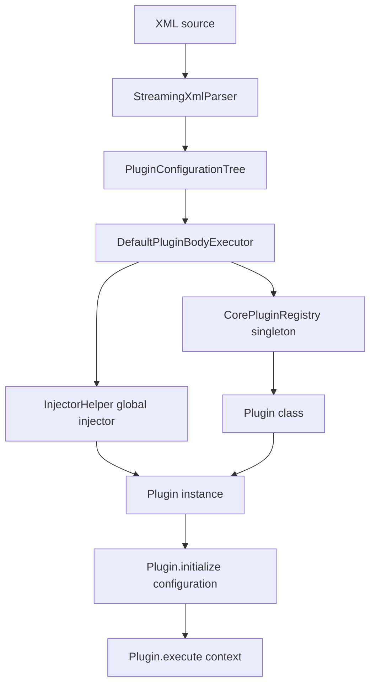
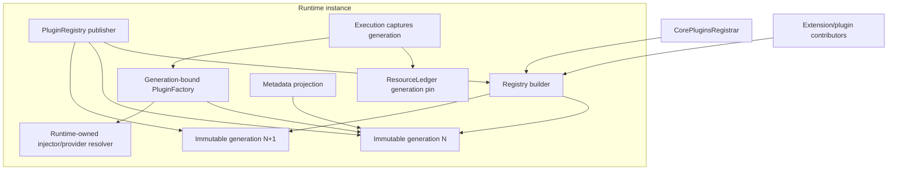
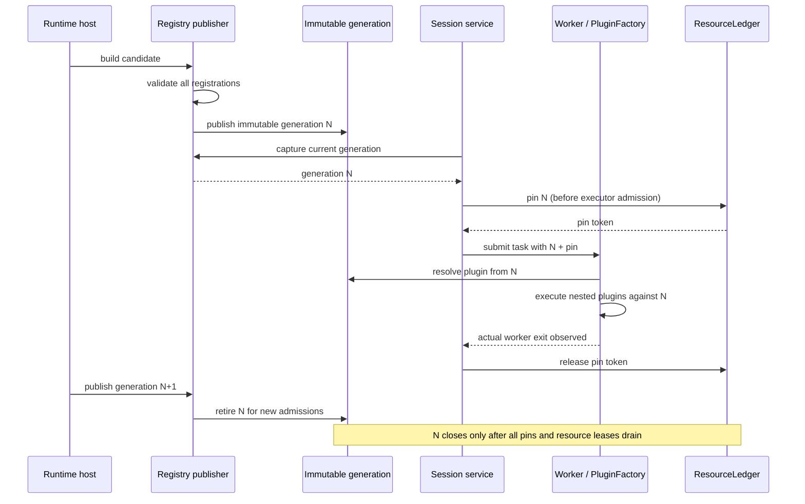

# Plugin Registry Generation Design

**Status:** Proposed architecture decision; implementation intentionally not included.
**Scope:** Core runtime plugin registration, XML element dispatch, plugin construction, metadata projection, and generation ownership required by runtime resource pinning.
**Related work:** [#377](https://github.com/web-harvest/web-harvest/issues/377), [#355](https://github.com/web-harvest/web-harvest/issues/355), [#354](https://github.com/web-harvest/web-harvest/issues/354), [#357](https://github.com/web-harvest/web-harvest/issues/357), [#349](https://github.com/web-harvest/web-harvest/issues/349).

## 1. Decision summary

WebHarvest must have **one runtime-owned plugin registry authority**. It publishes immutable generations. Every execution captures exactly one generation and resolves every plugin through that captured generation.

The candidate direction is to evolve the existing `PluginRegistry` contract rather than introduce a parallel registry family. This choice must be reconciled with the approved descriptor/SPI and Core inventory under #93/#94 before implementation; this document is a review proposal, not permission to bypass those architecture gates:

- `PluginRegistry` becomes the runtime-facing registry/publication API.
- `DefaultPluginRegistry` becomes its implementation, with mutable registration confined to a builder/staging phase and immutable published snapshots.
- `CorePluginsRegistrar` becomes a deterministic contributor of built-in registrations to a registry builder; it must not mutate a process-global singleton.
- `PluginFactory` remains a construction service, not a registry or source of plugin identity. Its runtime resolution methods must operate against a captured generation.
- `PluginMetadataCatalog` remains a read-only metadata projection. It must consume a generation snapshot and must never independently discover or instantiate a second plugin universe.
- `CorePluginRegistry` and `PluginRegistryHolder` are legacy global registry paths. They must be migrated to compatibility facades over an explicitly supplied runtime registry or deprecated and removed after call-site migration. They must not remain independent authorities.
- Static/global `InjectorHelper` resolution is not a valid generation-scoped construction mechanism. The runtime-owned composition boundary must supply the injector/provider used by the generation. This work coordinates with #357.

This is a proposed migration target, not authorization to change public compatibility behavior without characterization tests.

## 2. Source-confirmed current architecture

Inspection of `main` found multiple competing mechanisms with different responsibilities and lifetimes.

| Mechanism | Current behavior | Architectural classification |
|---|---|---|
| `CorePluginRegistry` | Process-wide singleton mapping XML element names to plugin classes; mutable map; `clear()` | **Actual XML dispatch registry today** |
| `CorePluginsRegistrar` | Static synchronized registration into `CorePluginRegistry.getInstance()`; one static `initialized` flag; invoked from `ScraperModule.configure()` | Global bootstrap mutator, not a runtime-owned publication |
| `PluginPackageScanner` | Opt-in package scanner that also mutates a supplied `CorePluginRegistry`; not wired by default `ScraperModule` | Optional registration path into the same global dispatch registry, not an independent publication lifecycle |
| `PluginRegistry` / `DefaultPluginRegistry` | Separate registration API and mutable maps for plugin instances, classes, metadata, namespace/element lookup | Parallel registry API; not the core XML dispatch authority |
| `PluginRegistryHolder` | Separate process-global singleton; classpath scans and registers annotated core plugins into `DefaultPluginRegistry` | Second global bootstrap path |
| `PluginFactory` / `DefaultPluginFactory` | Constructs plugin instances; ID/namespace lookup is delegated to injected `PluginRegistry` | Construction facade coupled to the parallel registry |
| `PluginMetadataCatalog` | Static initialization scans classes and instantiates plugins to build descriptors | Independent metadata discovery/projection; not a runtime registry |
| `StreamingXmlParser` | Creates `PluginConfigurationTree` nodes with `pluginClass == null`; resolver lookup is commented out | Parser currently does not bind a plugin registry generation |
| `DefaultPluginBodyExecutor.createChildPlugin()` | Looks up the class from global `CorePluginRegistry`, then obtains instances through static `InjectorHelper.getInjector()` (reflection fallback) | **Actual execution-time dispatch and construction path** |

Important consequence: a design centered only on `PluginRegistryHolder` or `PluginMetadataCatalog` would miss the current execution path. Conversely, simply extending `CorePluginRegistry` would leave the separate `PluginRegistry` API, factory, and metadata scanner as competing sources of truth.

The generation design must unify these paths deliberately.

## 3. Current execution path (source evidence)

Observed source details:

- `StreamingXmlParser.ConfigurationTreeHandler.startElement()` currently leaves `ElementInfo` null, creates a configuration node, and sets its `pluginClass` to null. The source contains a TODO to replace the old resolver with direct registry lookup.
- `DefaultPluginBodyExecutor.createChildPlugin()` calls `CorePluginRegistry.getInstance().getPluginClass(elementName)`, then `InjectorHelper.getInjector()`; if no injector is available it falls back to reflective construction.
- `ScraperModule.configure()` invokes `CorePluginsRegistrar.registerCorePlugins()` and requests static injection of `InjectorHelper`; the registrar populates the singleton with 44 built-in XML element mappings and protects initialization with a static flag.
- `PluginPackageScanner` can add explicitly scanned `@CorePlugin` classes to a supplied `CorePluginRegistry`, but the default `ScraperModule` does not wire/invoke it. Optional scanning is therefore a distinct opt-in path, not evidence of an automatically unified extension lifecycle.
- `PluginRegistryHolder.getInstance()` independently creates a `DefaultPluginRegistry` and scans `@CorePlugin` classes.
- `DefaultPluginFactory` resolves plugin IDs and namespace/element pairs through an injected `PluginRegistry`, not `CorePluginRegistry`.
- `PluginMetadataCatalog` has a static catalog build path using `PluginClassScanner` and reflective plugin construction.

The 44 XML mappings include executable plugins and declarative/parent-consumed XML nodes. The published registry descriptor must preserve that distinction; presence in the XML mapping table does not imply independent executable capability. See [CORE_PLUGIN_RUNTIME_EVIDENCE.md](CORE_PLUGIN_RUNTIME_EVIDENCE.md).

## 4. Target architecture

### 4.1 Registry publication

A runtime-owned publisher accepts a fully validated candidate and atomically publishes an immutable generation. The generation owns:

- a unique `RegistryGenerationId` issued by the runtime at publication;
- immutable lookup maps for XML element, plugin ID, namespace/element, and class identity as required by supported compatibility APIs;
- immutable plugin descriptors and registration metadata;
- the exact plugin implementation classes and the provider/injector/class-loader ownership needed to construct them;
- lifecycle state and retirement coordination.

A generation is not just a map of class names. It must represent the exact resolution and construction universe used by its sessions.

A failed candidate build must not alter the currently published generation. Publication is a single atomic swap after all registrations, duplicate checks, dependency checks, and provider setup succeed.

### 4.2 Session capture and resolution

At execution admission, the runtime captures the currently published generation and obtains its generation pin before executor submission. The task carries that captured generation through all nested plugin execution. Resolution never consults a mutable global registry again.

The XML parser remains concerned with syntax/configuration. It must not race a registry publication or resolve a class from a different generation than the executing session. The parsed configuration tree can remain class-neutral; runtime dispatch uses the captured generation.

### 4.3 Construction

`PluginFactory` is retained as the construction abstraction. It receives a generation-bound resolution context and a runtime-owned construction provider. It must not resolve IDs through a different mutable registry or use process-global injector lookup.

The factory must preserve existing constructor and Guice injection behavior through an explicit compatibility adapter while the runtime-owned composition boundary is migrated. Reflective fallback must be an explicit, tested policy rather than an invisible fallback that can bypass runtime ownership.

### 4.4 Metadata

`PluginMetadataCatalog` becomes a projection over a specific immutable generation. It does not scan the classpath, instantiate plugins, or maintain its own static descriptor universe during normal runtime operation.

If tooling needs metadata before a runtime is created, it may use a separate discovery/build pipeline that produces a candidate registry generation. That pipeline must publish through the same validation and descriptor rules; it is not a second runtime registry.

### 4.5 Retirement

When a new generation is published, the previous generation becomes retired for new admissions. Existing sessions that already pinned it may continue resolving and using its providers. The old generation is closed only after:

1. no new pin can be acquired;
2. all session generation pins are released after confirmed worker exit;
3. all operation/resource leases are drained;
4. owned provider/injector/class-loader close actions complete.

A timeout or unresponsive worker retains/quarantines the generation; it does not release ownership. This composes with #354 and #355.

## 5. Lifecycle and concurrency

Required race outcomes:

- **Submit vs publish:** each execution captures exactly one fully published generation.
- **Submit vs retire:** pin acquisition and retirement have one atomic winner; no admission can use a retired generation without a pin.
- **Queued cancellation:** release only after confirmed task removal/no-entry, or after the task body observes cancellation and exits.
- **Running cancellation:** release only after actual worker exit is observed.
- **Unresponsive worker:** retain the pin and quarantine resources/generation.
- **Multiple runtimes:** generation identity and publication/retirement state are runtime-scoped; runtime A cannot retire runtime B's generation.

## 6. Migration map (no parallel replacement mechanisms)

| Existing component | Target treatment |
|---|---|
| `PluginRegistry` | Evolve as the one canonical runtime registry/publication API |
| `DefaultPluginRegistry` | Implement candidate building and immutable generation publication; mutable maps never escape a build/published snapshot |
| `CorePluginRegistry` | Remove process-global ownership; temporary compatibility facade delegates to an explicitly supplied generation/runtime registry |
| `CorePluginsRegistrar` | Register built-ins into the canonical builder; remove static initialized flag and singleton mutation |
| `PluginPackageScanner` | Convert discovery output into candidate contributions to the canonical builder; discovery must not publish/mutate a live generation directly |
| `PluginRegistryHolder` | Deprecate/remove process-global holder after call-site migration; compatibility path must not instantiate a second registry |
| `PluginFactory` | Keep as construction API; all lookups require the captured generation |
| `DefaultPluginFactory` | Construct from generation-bound resolver and runtime-owned provider; no mutable registry lookup during execution |
| `PluginMetadataCatalog` | Immutable projection from a generation; remove static independent discovery in runtime use |
| `PluginClassScanner` | Retain only as an explicit candidate discovery input if needed; never as a parallel published registry |
| `StreamingXmlParser` | Keep class-neutral; remove stale resolver/POC comments when dispatch integration is complete |
| `DefaultPluginBodyExecutor` | Require an execution-bound generation/factory; remove global `CorePluginRegistry` and `InjectorHelper` lookups |
| `InjectorHelper` | Migrate as part of runtime composition/isolation (#357); no hidden global injector in generation-scoped plugin creation |

This map is a target, not a claim that every listed class can be removed immediately. Public API compatibility and extension behavior require characterization before deprecation/removal.

## 7. Compatibility and semantic constraints

- Preserve all 44 current core XML mappings, including legacy `set-var`, and preserve distinctions between executable plugins and declarative/parent-consumed nodes.
- Do not infer that every `@CorePlugin` class is a valid standalone XML dispatch mapping.
- Preserve plugin ID and namespace/element lookup semantics only where existing public API contracts require them; test collisions and precedence explicitly.
- Define duplicate ID, duplicate XML element, duplicate namespace/element, and alias behavior before publication.
- Avoid constructing plugin instances during catalog enumeration merely to read metadata.
- Do not share mutable plugin instances between sessions unless the plugin contract explicitly declares and tests that behavior. Generation ownership of classes/providers is distinct from per-invocation plugin instances.
- A class-loader/provider must not be closed while any pinned session or operation lease can still use it.
- Metadata schema version is not a generation identity. A content hash alone is not a lifetime identity.

## 8. Required implementation slices

1. **Characterization:** inventory every production and test call site of all registry/factory/catalog/singleton mechanisms; identify public API and extension compatibility contracts.
2. **Registry model:** define immutable generation, runtime-scoped ID, candidate builder, duplicate validation, atomic publication, and retirement API.
3. **Bootstrap unification:** route built-in registration and extension contributions through one builder; stop static singleton registration.
4. **Execution binding:** capture generation before task admission; pass it through session context and nested plugin execution.
5. **Construction isolation:** bind PluginFactory and provider/injector to the captured generation and runtime.
6. **Metadata projection:** derive catalog descriptors from the same published generation.
7. **Resource integration:** connect generation pins to #355 only after #354 worker-exit guarantees are verified.
8. **Legacy retirement:** deprecate/remove global holders and duplicate registries after compatibility tests pass.

Each slice must have focused tests and full Core/reactor quality gates. No step should merge on the basis of compilation alone.

## 9. Acceptance test matrix

| Area | Required deterministic test |
|---|---|
| Publication | Invalid candidate leaves the current generation unchanged |
| Identity | Two generations with identical metadata but distinct provider lifetimes have distinct IDs |
| Snapshot | Published maps/descriptors cannot be mutated by callers |
| Resolution | A session continues resolving from its captured generation after a newer publication |
| Duplicate rules | Duplicate IDs, element names, aliases, and namespace/element pairs fail deterministically |
| Admission race | Latch-controlled publish/capture/pin race has exactly one valid outcome |
| Retirement race | No new pin succeeds after retirement wins |
| Queued cancellation | Pin remains until confirmed no-entry/removal |
| Worker exit | Pin remains until actual exit, not merely terminal business status or Future cancellation |
| Quarantine | Non-cooperative worker prevents generation/provider close |
| Runtime isolation | Runtime A cannot resolve, pin, or retire runtime B's generation |
| Factory | All factory lookup paths resolve against the captured generation |
| Metadata | Catalog is derived from generation and does not independently instantiate/scan a second runtime registry |
| Compatibility | Existing public registry/factory APIs preserve documented behavior or have explicit migration tests |
| XML compatibility | All 44 mapping rows remain valid with declarative-node distinctions preserved |

## 10. Explicit non-goals

- No new competing `PluginRegistryV2`, `PluginManager`, `PluginCatalogRegistry`, or parallel factory hierarchy.
- No runtime implementation in this design-only change.
- No change to XML syntax, plugin semantics, or the 44 compatibility mappings.
- No claim that Java thread interruption can hard-kill a plugin.
- No integration of resource pins using fabricated generation IDs.
- No premature deletion of public legacy APIs without compatibility evidence.

## 11. Verification boundary

This document is based on source inspection of `main`. It does not claim that the target design has been implemented, tested, or approved by CI. Implementation remains gated by #93/#94 (Core inventory and descriptor/SPI approval), #377 (generation ownership), #349 (activation/lifecycle policy), and the dependent execution/resource contracts.

## 12. Historical XML element metadata and ElementsRegistry retirement

### 12.1 Correct responsibility classification

`ElementsRegistry` is not an executable plugin registry and must not be mechanically merged into `CorePluginRegistry`, `PluginRegistry`, or a plugin factory.

The current source shape is:

- `ElementsRegistry` is a thin interface extending the generic `Registry<ElementName, ElementInfo>`.
- `ElementsRegistryImpl` delegates all storage behavior to `AbstractRegistry`.
- `ElementName` represents an XML name/namespace pair. Its fields are non-final (there are no public setters), and its equality/ordering implementation is not a suitable canonical identity contract for a new runtime: it implements raw `Comparable`, and its constructor permits a null namespace URI even though `equals()` and `compareTo()` dereference that URI. It is also used by the legacy `XmlNode` tree as the key for child-element indexes and in public child-lookup methods.
- `ElementInfo` contains historical XML grammar and editor/validation metadata: permitted/required child names, permitted/required attributes, namespace-family attribute rules (`p:*` and `v:*`), suggested attribute values, internal-element markers and dependent-processor metadata.
- The old definition/processor class fields were removed, while the constructor still accepts class arguments and the corresponding getters return `null`. The remaining value collections and arrays are exposed as mutable references.

This metadata is valuable historical behavior. The old registry and mutable value objects are not an appropriate target architecture.

The distinction matters because the actual current XML execution dispatch path is separately represented by `CorePluginRegistry` and `DefaultPluginBodyExecutor`. A registry unification that only replaces `CorePluginRegistry` would leave XML grammar/validation metadata as a separate legacy subsystem; a mechanical merge of `ElementsRegistry` into plugin dispatch would incorrectly imply that every XML grammar node is an executable plugin.

### 12.2 Current parser qualification

The current `StreamingXmlParser` source has the old resolver/ElementInfo lookup commented out. Its handler assigns `elementInfo = null`, creates a `PluginConfigurationTree` node without a plugin class, and describes the fallback as a POC. Consequently, the current parser path does not consume the old `ElementsRegistry` metadata to validate the parsed tree.

The existing `ConfigParser` abstraction is also incomplete, and the current `XMLConfig.reload()` behavior is tied to a concrete parser implementation. The XML migration therefore needs to restore a real parser contract, not simply reconnect the old registry.

The existing `ElementInfoContractTest` currently protects required child/attribute markers, namespace wildcards, enumerated attribute values, internal markers and XML template generation. It is characterization evidence for the metadata vocabulary, not proof that the default parser currently applies these rules. `XmlNodeContractTest` covers same-namespace child lookup, attribute/text behavior and serialization round-tripping through `ElementName`. The current test tree has no dedicated `ElementsRegistry` contract test and does not characterize null-namespace `ElementName` equality/ordering. `XmlNode` has its own focused contract tests and must be included in the replacement inventory.

These are source observations, not proof that every historical XML validation behavior is currently exercised by the default parser. The complete production/test call-site and historical behavior inventory remains a required characterization task.

### 12.3 Target: one generation, separate typed projections

The runtime generation should own one coherent, immutable XML/plugin semantic snapshot, with distinct typed projections:

1. **Plugin descriptors** describe executable providers, construction contracts, capabilities, plugin configuration schemas and lifecycle.
2. **XML element descriptors** describe the accepted XML grammar, element identity, dialect applicability, child/attribute constraints, defaults, aliases, and whether an element is executable, declarative/parent-consumed, or compatibility-only.
3. **XML dialect descriptors/adapters** define historical parsing and normalization semantics for each supported XML format/version.

These are not three independently mutable registries. They are typed indexes and projections built and validated together, then published atomically as part of one immutable runtime generation. A declarative XML node may have an XML element descriptor without having a plugin provider. An executable plugin descriptor may reference one or more XML element identities and aliases.

Names such as `XmlElementDescriptor`, `XmlDialectDescriptor`, and `XmlElementCatalog` are conceptual only; final Java API names must follow the completed source inventory and descriptor/SPI review. Do not introduce an `ElementsRegistryV2` or another independently mutable registry.

### 12.4 Metadata migration rules

Migrate the semantics of `ElementInfo` into immutable, defensively copied descriptor data:

- allowed and required child expanded names;
- allowed and required attributes;
- namespace-family attribute rules;
- suggested/enum attribute values;
- internal and parent-consumed markers;
- dialect-specific defaults and normalization rules;
- source/documentation metadata where useful to diagnostics and tooling.

Use an immutable expanded XML name value (namespace URI + local name); do not reuse mutable `ElementName` as the canonical identity. Do not retain `Class<?>` references in parsed configuration nodes or XML grammar descriptors. Provider binding belongs to the plugin descriptor/factory projection for a pinned generation.

### 12.5 XML front-end pipeline

The target XML path is:

1. Parse XML syntax into a parser-neutral, namespace-aware syntax tree that preserves text, qualified attributes, namespace declarations and source locations.
2. Select the historical dialect adapter using explicit version/namespace/root rules.
3. Apply that dialect's exact name, attribute, text, alias and default semantics.
4. Validate the normalized syntax tree against immutable XML element descriptors in the selected runtime generation.
5. Produce a class-neutral canonical configuration tree/AST.
6. Resolve executable nodes through the plugin descriptors and generation-bound factory at execution/plan time; retain declarative nodes as configuration consumed by their parent.

The parser implementation must return the same canonical model through the `ConfigParser` contract. `XMLConfig` must not branch on `instanceof StreamingXmlParser`. Parsing/normalization must not consult a process-global registry or a different generation from the one selected for validation and execution.

### 12.6 Retirement decision

The intended end state is to replace and retire `ElementsRegistry`, `ElementsRegistryImpl`, `ElementInfo` and `ElementName` as the authoritative XML metadata model after their required semantics have been characterized and migrated.

A temporary compatibility adapter may be used only where a verified caller requires it during migration. It must delegate to an explicitly supplied immutable generation/dialect view and must not create another registry authority. Java API compatibility alone is not a reason to preserve the old classes; the mandatory compatibility boundary is the historical XML behavior.

### 12.7 Additional acceptance tests

- Every historical XML dialect fixture is parsed and normalized through the same parser contract.
- Child/attribute requiredness, namespace-family attributes, suggested values and internal-node behavior match characterized historical semantics.
- Namespace URI + local name identity, aliases and dialect-specific name collisions are deterministic.
- Declarative/parent-consumed nodes are accepted and represented without requiring a plugin implementation.
- Executable nodes resolve only through the pinned generation's plugin descriptor/factory.
- Parser output contains no implementation `Class<?>` binding and is independent of the concrete parser implementation.
- Invalid XML metadata candidates fail before publication and leave the last-known-good runtime generation unchanged.
- The old `ElementsRegistry` API has no production authority after migration; any temporary adapter is covered by explicit compatibility tests.
- `XmlNode` child indexing and lookup behavior is preserved or deliberately replaced by an equivalent immutable expanded-name index; all `ElementName` consumers are migrated before the old value type is removed.
- Null/empty namespace URI behavior is explicitly characterized and tested; the current `ElementName` constructor permits null URI while `equals()` and `compareTo()` dereference it.
- The migration adds explicit registry publication/lookup tests rather than assuming the generic `AbstractRegistry` tests characterize XML metadata semantics.

## 13. Configuration scopes and secret references

Plugin registry generations must reference configuration contracts, not absorb configuration ownership into the registry. WebHarvest configuration has distinct lifetimes and must not be represented by one untyped map.

The required conceptual scopes are:

| Scope | Lifetime / owner | Responsibility |
|---|---|---|
| Runtime variables | One execution and its nested scopes | Dynamic values produced/read/updated while a flow executes |
| Plugin instance configuration | One plugin instance or configured component | Typed initialization inputs validated against its descriptor schema |
| Global parameter context | A named host/application/environment context, captured as a versioned snapshot | Reusable values shared by flows and plugin instances |
| Secret provider | External or host-owned security boundary | Resolve sensitive references under an explicit access context |

Global parameters are analogous in purpose to Apache NiFi Parameter Contexts, but the WebHarvest model must define its own lifecycle, scoping, versioning and security behavior.

A global parameter context should be versioned and immutable once captured by an execution/configuration revision. References should be stable keys rather than copied values. Precedence/overrides (if supported) must be explicit and deterministic; ambient environment variables must not silently override declared configuration.

Plugin descriptors should declare typed configuration requirements and validation rules. A plugin instance receives its resolved, validated configuration through its creation context. It must not reach into a process-global parameter singleton or query a Vault implementation directly.

Runtime variables remain execution data. They are not global configuration, must not be implicitly persisted as parameter values, and must preserve existing expression/variable semantics unless a separately reviewed migration changes them.

### 13.1 Secret references are not ordinary parameter values

A global parameter may contain a typed secret reference, but secret material must remain under a separate provider boundary. For example, a configuration may refer to a logical secret such as `vault://services/weather/api-key`; this is illustrative syntax, not a frozen URI scheme or API.

The model must distinguish:

- ordinary literal parameter values;
- secret references and provider identity;
- resolved secret material/credential handles;
- certificates, private keys and other typed credential material that should not be coerced into ordinary strings.

Secret values must not be serialized into DSL/configuration exports, metadata catalogs, diagnostics or logs. Resolution must be authorized and auditable, and secret exposure should be minimized. APIs should avoid requiring immutable `String` values for secret material where a safer representation is practical.

### 13.2 Provider architecture

Define a neutral secret-resolution port and access context. Provider implementations may later support environment-backed values, protected local files, operating-system credential stores, HashiCorp Vault or other external secret managers. No specific provider or Vault dependency is required by Core.

The provider boundary must account for:

- explicit provider selection and reference validation;
- runtime/host identity and least-privilege access;
- redaction and safe diagnostic behavior;
- secret rotation and revocation;
- typed credentials/certificates as well as scalar tokens;
- offline operation and host-supplied providers;
- deterministic failure behavior when a provider is absent or access is denied;
- explicit resolution/rotation consistency semantics for a running execution.

Do not assume that a secret's plaintext should be copied into an immutable parameter snapshot. The snapshot should normally pin the reference and policy; whether resolution uses the latest value or a specific provider version must be an explicit policy decision. Rotation must not silently change a credential midway through an operation.

### 13.3 Ownership boundaries

- The runtime owns the parameter-context snapshot associated with an execution/configuration revision.
- The plugin factory supplies each plugin instance with its declared, validated configuration.
- The host/runtime supplies secret-resolution capability and access context.
- A plugin receives only the secret or credential capability it needs; it does not receive unrestricted access to every global parameter or secret.
- The registry generation may carry descriptor schemas and required capability declarations, but it does not store secret material or own a Vault client.

### 13.4 Design and implementation gates

Before implementation, characterize existing variable interpolation, `PluginConfiguration`, configuration loading, XML parameter/variable namespaces and plugin initialization. Then define versioning, scope visibility, override rules, expression evaluation order, secret reference semantics and failure behavior.

Acceptance must cover two independent runtimes with different parameter contexts/providers, execution snapshot consistency, nested runtime-variable scope behavior, plugin schema validation, secret redaction, denied/missing providers, rotation policy and absence of secret material from serialized DSL and logs.

This section records architectural requirements only. It does not claim that global parameter contexts, a Vault integration, or a new secret store are implemented.
